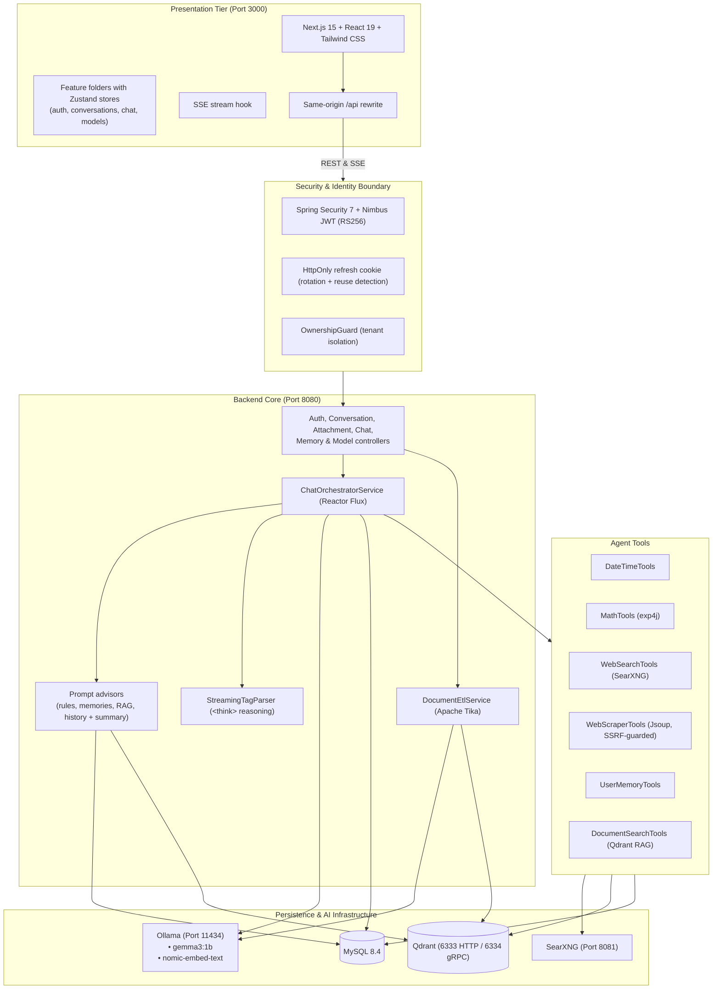

# LocalMind

> **Self-Hosted, Privacy-First Conversational AI Suite**  
> _100% Local Inference • No Cloud AI APIs • Multi-Tenant Security_

---

LocalMind is a self-hosted, multi-tenant conversational AI workspace for private or on-premise environments. It pairs a Next.js chat interface with a Spring Boot 4 and Spring AI 2 orchestration engine, local LLM execution via Ollama, vector search with Qdrant, private metasearch with SearXNG, and relational persistence with MySQL.

Prompts, documents, embeddings and chat history never leave your infrastructure. The only outbound traffic is web search through your own SearXNG instance and web pages the assistant is asked to read.

For the detailed design see [`docs/DESIGN.md`](docs/DESIGN.md); for how prompts are assembled see [`docs/PROMPT_GENERATION_PROCESS.md`](docs/PROMPT_GENERATION_PROCESS.md); coding conventions are in [`AGENTS.md`](AGENTS.md).

---

## Architecture Overview



---

## Core Features

- **Local inference:** chat and embeddings run on Ollama; no API keys and no cloud AI services. Pick any installed model per conversation or per message.
- **Server-Sent Events (SSE) streaming** with typed events:
  - `CONTENT`: answer text (Markdown).
  - `REASONING`: `<think>` reasoning tokens, shown in a collapsible accordion with the thinking time.
  - `TOOL_START` / `TOOL_END`: live tool badges.
  - `DONE`: completion, with the persisted message ID.
  - `ERROR`: a user-facing error message (details stay in the server log).
- **Context-aware prompts:** custom instructions, pinned and semantically relevant memories, automatic document excerpts (RAG), and conversation history trimmed to the model's token budget, with a rolling summary of older turns. New conversations get an automatic title.
- **Tools with a capability guardrail:**
  - **Date/time:** current date, time, day of week and server time zone.
  - **Math evaluator:** expressions evaluated deterministically by `exp4j`.
  - **Private web search:** through the local SearXNG instance.
  - **Web page reader:** readable text via Jsoup; only offered when the message contains a URL. Every redirect hop is checked against loopback, private, link-local and other internal address ranges (SSRF protection).
  - **User memory:** save and recall facts about the user across conversations.
  - **Document search (RAG):** semantic search over the conversation's uploaded documents.
  - **Guardrail:** tools are only offered to models that support them (capabilities reported by Ollama, with a fallback list); the UI disables the Tools switch for other models, and at most 5 tool calls run per turn.
- **Documents:** drag-and-drop upload of `pdf`, `docx`, `txt` and `md` files (up to 25 MB), with automatic conversation creation and ingestion status chips (`PROCESSING`, `READY`, `FAILED`). Deleting a conversation also deletes its files and vectors.
- **Long-term memories API:** list, pin and delete the memories the assistant saved (`/api/memories`; no UI yet).
- **Authentication & tenant isolation:**
  - 15-minute access tokens (RS256), held only in browser memory.
  - 7-day HttpOnly, `SameSite=Strict` refresh tokens, stored as SHA-256 hashes and rotated on every use; replaying an old token revokes all of the user's sessions (parallel refreshes from several tabs within 10 seconds are allowed).
  - Every conversation, message, attachment, memory and stream endpoint is scoped to the authenticated user.
  - Errors are returned as RFC 9457 problem details with a `message` field.
- **Rich rendering:**
  - KaTeX math (`$...$` and `$$...$$`).
  - Prism-highlighted code blocks with language aliases and a copy button.
  - Pinned conversations and inline title renaming.

---

## System Requirements & Prerequisites

| Dependency                  | Minimum Version           | Notes                                          |
| :-------------------------- | :------------------------ | :--------------------------------------------- |
| **Docker Desktop / Engine** | 24.0+                     | Docker Compose v2; runs MySQL, Qdrant, SearXNG |
| **Java JDK**                | 25                        | Spring Boot backend                            |
| **Node.js**                 | 18.18+ (tested on 20, 22) | Next.js 15 frontend                            |
| **Ollama**                  | Recent release            | Runs natively at `http://127.0.0.1:11434`      |

---

## Quick Start (Automated)

Start the Docker services, pull the Ollama models if missing, and run the backend and frontend with one command:

**Windows (PowerShell):**

```powershell
.\scripts\run-local.ps1
```

**Linux / macOS / Git Bash:**

```bash
./scripts/run-local.sh
```

Once started:

- **Web UI:** [http://localhost:3000](http://localhost:3000)
- **Backend API:** [http://localhost:8080](http://localhost:8080) (health: `/actuator/health`)
- **SearXNG:** [http://localhost:8081](http://localhost:8081)
- **Qdrant dashboard:** [http://localhost:6333/dashboard](http://localhost:6333/dashboard)

---

## Manual Step-by-Step Setup

### 1. Launch Infrastructure Services

```bash
docker compose -f docker/docker-compose.yml up -d --wait
```

The images are pinned (`mysql:8.4`, `qdrant/qdrant:v1.20.1`, a dated `searxng/searxng` tag). To override credentials, ports or image tags, copy `docker/.env.example` to `docker/.env` first.

### 2. Pull Required Ollama Models

```bash
ollama pull gemma3:1b
ollama pull nomic-embed-text
```

Pull a tool-capable model such as `qwen2.5:7b` as well if you want the assistant to use tools.

### 3. Run the Backend (Spring Boot)

```bash
cd backend
./mvnw spring-boot:run
```

The backend starts on port `8080`. Hibernate creates and updates the database schema (`ddl-auto: update`), Spring AI creates the Qdrant collection, and the JWT signing key is generated in `backend/data/` on first start (git-ignored; keep it private).

### 4. Run the Frontend (Next.js)

```bash
cd frontend
cp .env.local.example .env.local   # optional: only needed if the backend is not on localhost:8080
npm install
npm run dev
```

The frontend starts on [http://localhost:3000](http://localhost:3000). The browser only calls same-origin `/api/**`, which Next.js forwards to `BACKEND_API_URL`.

---

## Configuration Reference

Every setting uses a `${VARIABLE:default}` placeholder in `backend/src/main/resources/application.yml` (backend) and `${VARIABLE:-default}` in `docker/docker-compose.yml` (containers). The defaults work out of the box; set an environment variable only to change one. Both read the same names, so a value such as `MYSQL_PASSWORD` must be set for both. For compose, copy `docker/.env.example` to `docker/.env`.

| Environment Variable           | Default                                       | Used by          | Description                                                                             |
| :----------------------------- | :-------------------------------------------- | :--------------- | :-------------------------------------------------------------------------------------- |
| `MYSQL_HOST`                   | `127.0.0.1`                                   | backend          | MySQL host                                                                              |
| `MYSQL_PORT`                   | `3306`                                        | backend, compose | MySQL port                                                                              |
| `MYSQL_DATABASE`               | `localmind`                                   | backend, compose | Database name                                                                           |
| `MYSQL_USER`                   | `localmind`                                   | backend, compose | Database user                                                                           |
| `MYSQL_PASSWORD`               | `localmind`                                   | backend, compose | Database password                                                                       |
| `MYSQL_ROOT_PASSWORD`          | `admin`                                       | compose          | MySQL root password                                                                     |
| `OLLAMA_BASE_URL`              | `http://127.0.0.1:11434`                      | backend          | Ollama API endpoint                                                                     |
| `OLLAMA_CHAT_MODEL`            | `gemma3:1b`                                   | backend          | Default chat model                                                                      |
| `OLLAMA_EMBEDDING_MODEL`       | `nomic-embed-text`                            | backend          | Embedding model                                                                         |
| `QDRANT_HOST`                  | `127.0.0.1`                                   | backend          | Qdrant host                                                                             |
| `QDRANT_GRPC_PORT`             | `6334`                                        | backend, compose | Qdrant gRPC port                                                                        |
| `QDRANT_HTTP_PORT`             | `6333`                                        | compose          | Qdrant HTTP port                                                                        |
| `QDRANT_COLLECTION`            | `localmind_vectors`                           | backend          | Vector collection name                                                                  |
| `SEARXNG_BASE_URL`             | `http://127.0.0.1:8081`                       | backend          | SearXNG endpoint                                                                        |
| `SEARXNG_PORT`                 | `8081`                                        | compose          | SearXNG host port                                                                       |
| `SEARXNG_SECRET`               | `localmind_searxng_secret_key`                | compose          | SearXNG secret key                                                                      |
| `SERVER_PORT`                  | `8080`                                        | backend          | Backend HTTP port                                                                       |
| `CORS_ALLOWED_ORIGINS`         | `http://localhost:3000,http://127.0.0.1:3000` | backend          | Browser origins allowed to call the API directly                                        |
| `JWT_KEY_FILE`                 | `./data/jwt-signing-key.pem`                  | backend          | RSA key signing access tokens (created on first start)                                  |
| `JWT_ACCESS_TOKEN_EXPIRATION`  | `15m`                                         | backend          | Access token lifetime                                                                   |
| `JWT_REFRESH_TOKEN_EXPIRATION` | `7d`                                          | backend          | Refresh token lifetime                                                                  |
| `JWT_COOKIE_SECURE`            | `false`                                       | backend          | Set `true` behind HTTPS                                                                 |
| `UPLOAD_DIR`                   | `./uploads`                                   | backend          | Attachment storage directory                                                            |
| `UPLOAD_MAX_FILE_SIZE`         | `25MB`                                        | backend          | Max upload size                                                                         |
| `BACKEND_API_URL`              | `http://localhost:8080`                       | frontend         | Backend the Next.js server proxies `/api/**` to; read at `next build` (and `next dev`) |

See `application.yml` for the remaining switches (`JPA_*`, `PROMPT_*`, `UPLOAD_ALLOWED_EXTENSIONS`, `SCRAPER_ALLOW_PRIVATE_SUBNETS`) and `docker/.env.example` for the image tags.

---

## API Endpoints & SSE Streaming Protocol

All endpoints except registration, login, refresh, logout and `/actuator/health` require `Authorization: Bearer <access_token>`. Errors are returned as `application/problem+json`, for example:

```json
{ "type": "about:blank", "title": "Not Found", "status": 404, "detail": "Memory not found", "message": "Memory not found" }
```

### Authentication (`/api/auth`)

- `POST /api/auth/register` — Register an account (`email`, `password` of 8–72 characters, `fullName`).
- `POST /api/auth/login` — Authenticate; returns an access token and sets the HttpOnly refresh cookie.
- `POST /api/auth/refresh` — Rotate the refresh cookie and issue a new access token.
- `POST /api/auth/logout` — Revoke the presented refresh token and clear the cookie.
- `GET /api/auth/me` — Current user profile.
- `PATCH /api/auth/me` — Update full name and custom instructions.

### Conversations (`/api/conversations`)

- `GET /api/conversations` — List the user's conversations, most recently updated first.
- `POST /api/conversations` — Create a conversation (title defaults to `New Chat` and is replaced automatically after the first answer).
- `PATCH /api/conversations/{id}` — Update title, pinned flag or model.
- `GET /api/conversations/{id}/messages` — Message history in chronological order.
- `DELETE /api/conversations/{id}` — Delete the conversation with its messages, attachments, stored files and document vectors.

### Attachments & RAG (`/api/conversations/{conversationId}/attachments`)

- `POST /api/conversations/{conversationId}/attachments` — Upload a document (`.pdf`, `.docx`, `.txt`, `.md`, multipart/form-data); returns `202 Accepted` while it is indexed in the background.
- `GET /api/conversations/{conversationId}/attachments` — List attachments and their status (`PENDING`, `PROCESSING`, `READY`, `FAILED`).
- `GET /api/conversations/{conversationId}/attachments/{attachmentId}/download` — Download the original file.

### Memories (`/api/memories`)

- `GET /api/memories` — List the long-term memories the assistant saved about the user.
- `PATCH /api/memories/{id}` — Pin or unpin a memory (`{"pinned": true}`); pinned memories are always included in the system prompt.
- `DELETE /api/memories/{id}` — Delete a memory and its embedding.

### Models (`/api/models`)

- `GET /api/models` — Installed Ollama models, each with `supportsTools`.

### Real-time Streaming (`/api/chat/stream`)

**Request:**

```http
POST /api/chat/stream
Content-Type: application/json
Accept: text/event-stream
Authorization: Bearer <access_token>

{
  "conversationId": "3fa85f64-5717-4562-b3fc-2c963f66afa6",
  "message": "Calculate (45 * 12) + sqrt(144).",
  "model": "qwen2.5:7b",
  "toolsEnabled": true
}
```

`model`, `toolsEnabled` (default `true`) and `systemPrompt` are optional. Tools are only registered when the model supports them.

**SSE events streamed:**

```text
data:{"type":"TOOL_START","tool":"calculateExpression"}

data:{"type":"TOOL_END","tool":"calculateExpression"}

data:{"type":"CONTENT","content":"(45 × 12) + √144 = **552**."}

data:{"type":"DONE","messageId":"a812ef94-9140-4bd2-97b4-3a2135082121"}
```

Reasoning models (e.g. `deepseek-r1`) additionally emit `REASONING` events for their `<think>` output.

---

## Testing & Quality Assurance

### Backend Tests (JUnit 5, Mockito, MockMvc)

The suite runs on an in-memory H2 database (`test` profile), so no MySQL, Qdrant or Ollama is needed. `verify` also runs the Spotless format check:

```bash
cd backend
./mvnw verify
```

The live end-to-end test needs the full stack (Docker services and Ollama with `gemma3:1b`) and only runs when enabled:

```bash
LOCALMIND_LIVE_TESTS=true ./mvnw test -Dtest=EndToEndChatIntegrationTest
```

### Frontend Tests (Vitest + React Testing Library)

```bash
cd frontend
npm run lint
npm run typecheck
npm test
npm run format:check
npm run build
```

---

## Security Model

1. **Data stays local:** prompts, documents, embeddings and history are processed and stored on your own infrastructure; no telemetry or cloud AI APIs. Outbound requests are limited to SearXNG searches and pages the assistant reads.
2. **Tenant isolation:** every conversation, message, attachment and memory is scoped to the authenticated user (`OwnershipGuard`, user-scoped queries), and every vector search and delete is filtered by user (and conversation). Tools receive the user from the server, never from the model.
3. **Session hygiene:** access tokens expire after 15 minutes; refresh tokens rotate on every use, and replaying an old one (after a 10-second grace window for parallel tabs) revokes all of the user's sessions. The signing key persists across restarts.
4. **Tool sandboxing:** at most 5 tool calls per turn; the page reader blocks internal addresses on every redirect hop; tool failures are returned to the model as plain messages.
5. **Model tool-compatibility guardrail:** capability discovery from Ollama, a disabled Tools switch in the UI, and server-side tool suppression keep models without function calling from failing.
6. **No leaked internals:** clients only see fixed error messages; details are logged. Only `/actuator/health` is public, and its details require authentication.
