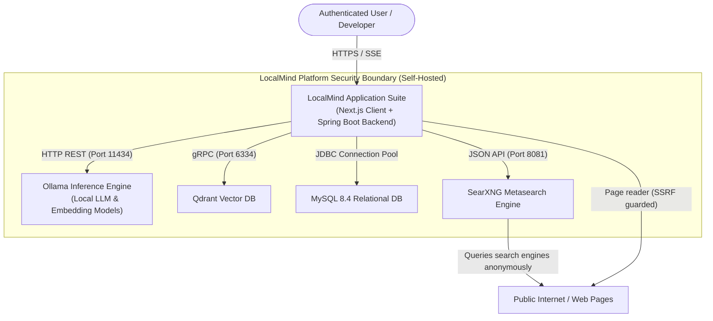
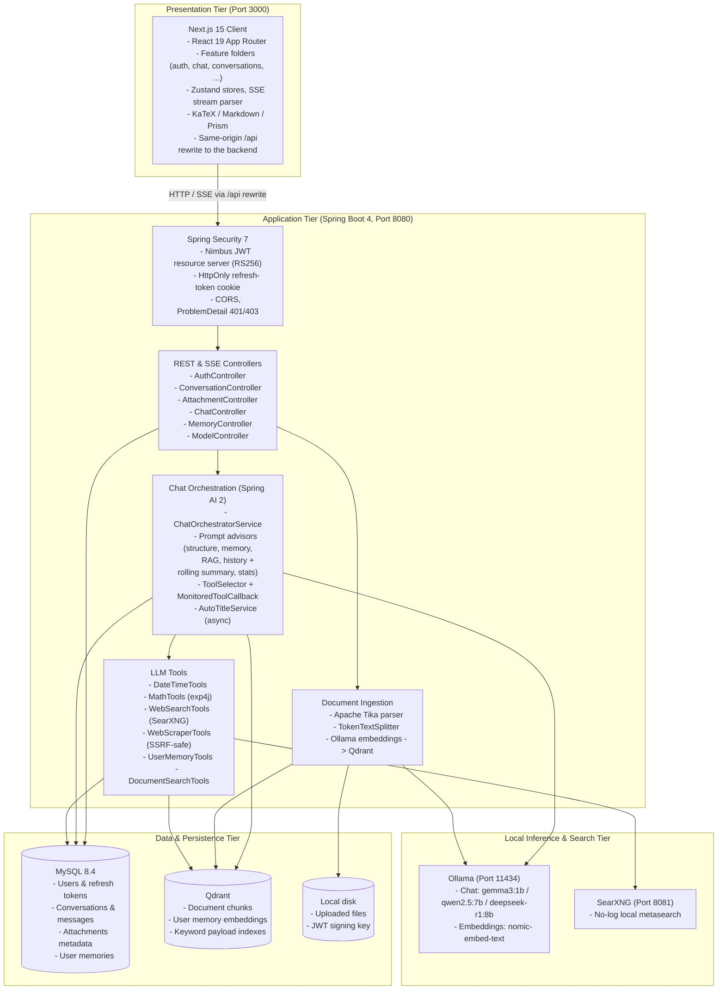
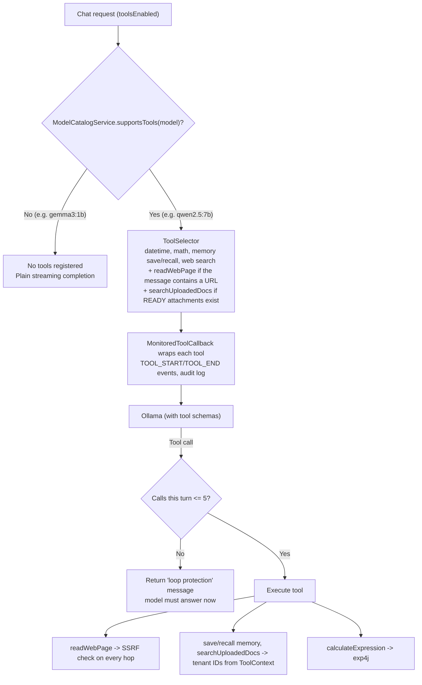
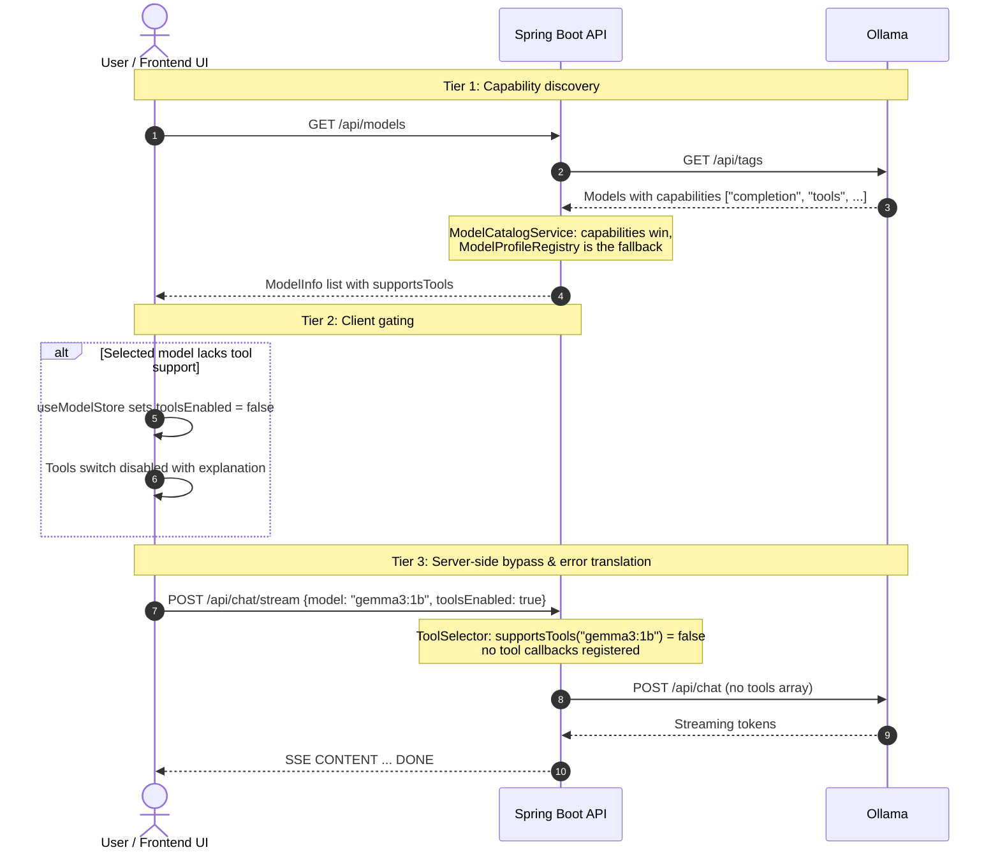

# LocalMind Platform: Engineering Design Document

> Describes the system as implemented. Coding conventions live in [`AGENTS.md`](../AGENTS.md); the prompt-assembly
> pipeline is detailed in [`PROMPT_GENERATION_PROCESS.md`](PROMPT_GENERATION_PROCESS.md).

---

## 1. Executive Summary & Architectural Motivation

### 1.1 Problem Statement

Enterprise and developer reliance on hosted conversational AI models (e.g., OpenAI ChatGPT, Anthropic Claude) introduces non-negotiable compliance and privacy risks:

- Sensitive proprietary code, internal technical specs, and customer PII are transmitted over third-party networks.
- Long-term memory and chat histories reside in external vendor databases without sovereign cryptographic custody.
- Metered API pricing introduces unpredictable operational expenditures.

### 1.2 System Vision

**LocalMind** is a self-hosted, privacy-first conversational platform. It runs local open-weight models through Ollama, persists relational state in MySQL 8.4, performs vector search in Qdrant, searches the web privately through SearXNG, and serves a Next.js chat frontend that streams responses over Server-Sent Events (SSE).

### 1.3 Key Architectural Principles

1. **No external data exfiltration:** prompts, documents and embeddings stay inside the self-hosted network. The only outbound traffic is web search (through SearXNG) and pages the model explicitly asks to read.
2. **Per-request model choice:** a lightweight model (`gemma3:1b`) runs on consumer hardware, while any installed model (`qwen2.5:7b`, `deepseek-r1:8b`, …) can be chosen per conversation or per message. Context budgets adapt to the model (`ModelProfile`).
3. **Strict multi-tenant isolation:** every relational query and every vector search is scoped to the authenticated user (and conversation where relevant). Tenant identifiers come from the verified JWT, never from the model or the request body.
4. **Concurrency on virtual threads:** Java 25 with `spring.threads.virtual.enabled=true`, so long-lived SSE streams and `@Async` jobs do not exhaust platform threads.
5. **Defensive tool calling:** tools are offered only to models that support them, tool loops are capped, scraped URLs are SSRF-checked on every redirect hop, and arithmetic is delegated to a deterministic evaluator.

---

## 2. System Context & Container Architecture (C4 Model)

### 2.1 System Context (C4 Level 1)



### 2.2 Container Architecture (C4 Level 2)



The backend runs on the host (`./mvnw spring-boot:run`); `docker/docker-compose.yml` provides MySQL, Qdrant and SearXNG with pinned image versions; Ollama runs natively. Every setting is an environment-variable placeholder with a working local default (see the README configuration table).

---

## 3. Data Architecture & Multi-Tenancy Strategy

### 3.1 Relational Schema (MySQL 8.4)

The schema is generated from the JPA entities by Hibernate (`spring.jpa.hibernate.ddl-auto: update`); there are no migration scripts. Primary keys are UUID strings (`VARCHAR(36)`) assigned in `@PrePersist`. Entities reference each other by ID only, so **there are no foreign-key constraints**: cascading deletes are performed by the services (Section 3.5) and tenant scoping by the queries (Section 4.3).

| Table | Entity | Columns (type) | Notes |
| :---- | :----- | :------------- | :---- |
| `users` | `user.entity.User` | `id`, `email` (255, unique), `password_hash` (255, BCrypt), `full_name` (100), `custom_instructions` (TEXT), `created_at` | Email normalised to lower case. |
| `refresh_tokens` | `auth.entity.RefreshToken` | `id`, `user_id`, `token_hash` (255, unique, SHA-256 of the raw token), `expires_at`, `revoked`, `rotated_at`, `created_at` | `rotated_at` is set only when a token is exchanged, not on logout (Section 4.1). |
| `conversations` | `conversation.entity.Conversation` | `id`, `user_id`, `title` (255), `model_name` (100), `summary` (TEXT), `summarized_through`, `pinned`, `created_at`, `updated_at` | Default title `New Chat` until auto-titled. `summarized_through` marks the newest message already folded into `summary`. |
| `messages` | `conversation.entity.ChatMessage` | `id`, `conversation_id`, `role` (`USER`/`ASSISTANT`), `content` (LONGTEXT), `reasoning_content` (LONGTEXT), `tool_calls` (JSON), `token_count`, `created_at` | `tool_calls` is the audit trail of tool invocations for the turn. |
| `attachments` | `attachment.entity.Attachment` | `id`, `conversation_id`, `user_id`, `file_name` (255), `file_type` (100), `file_size`, `status` (`PENDING`/`PROCESSING`/`READY`/`FAILED`), `chunk_count`, `error_message` (TEXT), `created_at` | `error_message` holds a fixed user-facing text, never exception details. |
| `user_memories` | `memory.entity.UserMemory` | `id`, `user_id`, `memory_fact` (TEXT), `pinned`, `created_at` | Pinned memories are always included in the system prompt. |

Request validation mirrors these column sizes (e.g. `@Size(max = 100)` on `fullName`), so oversized input is rejected with `400` before it reaches the database.

### 3.2 Conversation History & Prompt Assembly

Multi-turn history lives only in the `messages` table; there is no separate Spring AI chat-memory store. For every turn `ChatOrchestratorService` saves the user message first, then assembles the prompt through five ordered `PromptAdvisor`s:

| Order | Advisor | Contribution |
| :---: | :------ | :----------- |
| 100 | `PromptStructureAdvisor` | System message: base rules, request system prompt, user custom instructions, pinned memories |
| 200 | `MemoryRetrievalAdvisor` | Appends semantically relevant (non-pinned) memories to the system message |
| 300 | `AutoRagAdvisor` | Prepends the best document excerpts to the user message when the conversation has `READY` attachments |
| 400 | `HistoryAdvisor` | Inserts the rolling summary and the token-trimmed history between the system message and the current turn; hands turns that no longer fit to `ConversationSummaryService` |
| 500 | `PromptStatsAdvisor` | Logs the token distribution and warns on context overflow |

The final message order is `[system, summary, history…, current user message]`. Token budgets come from the model's `ModelProfile`. Details: [`PROMPT_GENERATION_PROCESS.md`](PROMPT_GENERATION_PROCESS.md).

Background updates never save a conversation entity loaded earlier. The end of a stream, auto-titling and the rolling summary use targeted `UPDATE` queries (`ConversationRepository#touch`, `#replacePlaceholderTitle`, `#updateSummary`), so a rename or pin made during a long response is never overwritten, and auto-titling only replaces the placeholder title.

### 3.3 Vector Database Design & Payload Isolation (Qdrant)

- **Collection:** `localmind_vectors` (`QDRANT_COLLECTION`), created by Spring AI (`spring.ai.vectorstore.qdrant.initialize-schema`) with the embedding model's dimension (768 for `nomic-embed-text`) and **Cosine** distance. HNSW parameters are Qdrant defaults.
- **Payload indexes:** `QdrantConfig` ensures keyword indexes on `userId`, `conversationId`, `type` and `memoryId` at startup.
- **Payloads** (text is stored by Spring AI under `doc_content`):

  ```json
  // Document chunk (DocumentEtlService)
  { "userId": "…", "conversationId": "…", "attachmentId": "…", "fileName": "guide.pdf",
    "type": "DOC_CHUNK", "chunkIndex": 4 }

  // User memory (UserMemoryTools)
  { "userId": "…", "memoryId": "…", "type": "USER_MEMORY" }
  ```

- **Non-bypassable tenant filters** (`common.ai.VectorFilters`), applied to every search and delete:
  - Document chunks: $(\text{userId} = u) \land (\text{conversationId} = c) \land (\text{type} = \text{DOC\_CHUNK})$
  - Memories: $(\text{userId} = u) \land (\text{type} = \text{USER\_MEMORY})$, plus $\text{memoryId}$ when deleting one memory.

### 3.4 Binary File Storage

File persistence sits behind the `FileStorageService` abstraction. Storage coordinates (`userId`, `attachmentId`, `originalFileName`) are passed explicitly, so no mutable path is stored in the database:

```java
public interface FileStorageService {
    void store(InputStream inputStream, String userId, String attachmentId, String originalFileName);
    Resource loadAsResource(String userId, String attachmentId, String originalFileName);
    /** Deletes the stored file if present; failures are logged, never thrown. */
    void delete(String userId, String attachmentId, String originalFileName);
}
```

`LocalDiskStorageService` is the only implementation. Files are stored as `${UPLOAD_DIR:./uploads}/{userId}/{attachmentId}_{sanitizedName}`: the name is reduced to its last path segment, non `[a-zA-Z0-9._-]` characters are replaced, and the resolved path must stay inside the user's directory. Another backend (e.g. S3/MinIO) can be added by implementing the interface; none exists today.

### 3.5 Deletion & Consistency

External side effects are tied to the transaction outcome through `common.transaction.TransactionHooks`:

- **Upload:** the file is stored, then the row is saved. After commit the ETL job starts; on rollback the stored file is deleted.
- **Conversation delete:** attachment rows, messages and the conversation are deleted in one transaction; after commit the stored files and the conversation's document chunks in Qdrant are deleted.
- **ETL racing a delete:** if the conversation is deleted while a document is being processed, the job discards its chunks instead of saving the attachment back.
- **Memory delete:** the row is deleted; after commit its embedding is removed from Qdrant. If embedding a new memory fails, the just-saved row is removed again.

---

## 4. API Gateway, Authentication & Security Architecture

### 4.1 Hybrid JWT & HttpOnly Cookie Protocol

Tokens are never written to browser storage:

- **Access token:** RS256 JWT, 15 minutes (`JWT_ACCESS_TOKEN_EXPIRATION`), returned in the JSON body and kept only in JavaScript memory by the frontend `apiClient`. Claims: `iss` (`localmind`), `sub`/`userId`, `email`, `fullName`. The RSA-2048 signing key is loaded from `JWT_KEY_FILE` (generated on first start, git-ignored), so tokens survive restarts.
- **Refresh token:** 32 random bytes (Base64URL), 7 days (`JWT_REFRESH_TOKEN_EXPIRATION`), only its SHA-256 hash is stored. Sent exclusively as an HttpOnly cookie scoped to the auth endpoints:

  ```http
  Set-Cookie: refreshToken=<opaque_token>; Path=/api/auth; Max-Age=604800; Expires=<date>; HttpOnly; SameSite=Strict
  ```

  `Secure` is added when `JWT_COOKIE_SECURE=true` (required behind HTTPS).
- **Rotation & reuse detection:** every refresh revokes the presented token and issues a new one. The token row is locked (`PESSIMISTIC_WRITE`) so parallel refreshes are serialized. A token rotated less than 10 seconds ago is still accepted, so several browser tabs refreshing with the same cookie each get a new token. A revoked token presented later than that is treated as theft: all of the user's refresh tokens are deleted. A logged-out token never gets the grace window.

### 4.2 API Endpoint Contract Catalog

| Method   | Endpoint                                                          | Auth          | Purpose                                                        | Success Code                 |
| :------- | :---------------------------------------------------------------- | :------------ | :------------------------------------------------------------- | :--------------------------- |
| `POST`   | `/api/auth/register`                                              | Public        | Create an account                                              | `201 Created`                |
| `POST`   | `/api/auth/login`                                                 | Public        | Authenticate, return access token, set refresh cookie          | `200 OK`                     |
| `POST`   | `/api/auth/refresh`                                               | Cookie        | Rotate refresh token and issue a new access token              | `200 OK`                     |
| `POST`   | `/api/auth/logout`                                                | Cookie        | Revoke refresh token and clear the cookie                      | `204 No Content`             |
| `GET`    | `/api/auth/me`                                                    | Bearer        | Current user profile                                           | `200 OK`                     |
| `PATCH`  | `/api/auth/me`                                                    | Bearer        | Update full name and custom instructions                       | `200 OK`                     |
| `GET`    | `/api/conversations`                                              | Bearer        | List the user's conversations (most recently updated first)    | `200 OK`                     |
| `POST`   | `/api/conversations`                                              | Bearer        | Create a conversation (title defaults to `New Chat`)           | `201 Created`                |
| `PATCH`  | `/api/conversations/{id}`                                         | Bearer        | Update title, pinned flag or model                             | `200 OK`                     |
| `DELETE` | `/api/conversations/{id}`                                         | Bearer        | Delete conversation, messages, attachments, files and chunks   | `204 No Content`             |
| `GET`    | `/api/conversations/{id}/messages`                                | Bearer        | Message history in chronological order                         | `200 OK`                     |
| `POST`   | `/api/conversations/{conversationId}/attachments`                 | Bearer        | Upload a document (multipart, `pdf`/`txt`/`docx`/`md`, 25 MB)  | `202 Accepted`               |
| `GET`    | `/api/conversations/{conversationId}/attachments`                 | Bearer        | List attachments and ingestion status                          | `200 OK`                     |
| `GET`    | `/api/conversations/{conversationId}/attachments/{id}/download`   | Bearer        | Download the original file                                     | `200 OK (binary)`            |
| `POST`   | `/api/chat/stream`                                                | Bearer        | Stream a chat turn                                             | `200 OK (text/event-stream)` |
| `GET`    | `/api/memories`                                                   | Bearer        | List the user's long-term memories                             | `200 OK`                     |
| `PATCH`  | `/api/memories/{id}`                                              | Bearer        | Pin or unpin a memory                                          | `200 OK`                     |
| `DELETE` | `/api/memories/{id}`                                              | Bearer        | Delete a memory and its embedding                              | `204 No Content`             |
| `GET`    | `/api/models`                                                     | Bearer        | Installed Ollama models with `supportsTools`                   | `200 OK`                     |
| `GET`    | `/actuator/health`                                                | Public        | Health probe (details only for authenticated callers)          | `200 OK`                     |

**Error format.** Every error is an RFC 9457 `application/problem+json` body with an extra `message` property that the frontend displays:

```json
{ "type": "about:blank", "title": "Not Found", "status": 404, "detail": "Memory not found",
  "message": "Memory not found" }
```

Business errors (`ApiException` subclasses), validation errors, standard Spring MVC errors and 401/403 from the security filter chain (`ProblemDetailSecurityHandler`, which keeps the `WWW-Authenticate` header) all use this format. Unexpected exceptions return `500` with a generic message; exception details are only logged.

### 4.3 Insecure Direct Object Reference (IDOR) Guardrails

The caller's identity always comes from the verified JWT through `@CurrentUserId`, never from the request body. Every conversation-scoped operation (conversations, messages, attachments, chat) first calls `conversation.service.OwnershipGuard`:

```java
@Component
@RequiredArgsConstructor
public class OwnershipGuard {

    private final ConversationRepository conversationRepository;

    public void validateConversationOwnership(String conversationId, String userId) {
        if (conversationId == null || userId == null
                || !conversationRepository.existsByIdAndUserId(conversationId, userId)) {
            throw new AccessDeniedException("Access denied: Conversation does not belong to user");
        }
    }
}
```

A violation becomes a `403` ProblemDetail. Attachments are additionally loaded with `findByIdAndUserId` and must belong to the conversation in the URL; memories are loaded with `findByIdAndUserId`, so another user's memory is reported as `404`. Tools receive `userId` and `conversationId` through the server-built `ToolContext`, never from model arguments.

---

## 5. Streaming Protocol & Event-Driven Wire Specification

### 5.1 Server-Sent Events (SSE) Wire Format

`POST /api/chat/stream` returns `text/event-stream`. Each event carries one `ChatEvent` JSON object; fields that are `null` are omitted:

```text
data:{"type":"CONTENT","content":"Hello"}
```

### 5.2 Event Taxonomy

| Event Type   | Attributes                                    | Meaning                                                   |
| :----------- | :-------------------------------------------- | :-------------------------------------------------------- |
| `CONTENT`    | `{"type":"CONTENT","content":"..."}`          | Answer text chunk (Markdown)                              |
| `REASONING`  | `{"type":"REASONING","content":"..."}`        | Text inside `<think>…</think>`, split out by `StreamingTagParser` (handles tags cut across chunks) |
| `TOOL_START` | `{"type":"TOOL_START","tool":"searchWeb"}`    | A tool call started                                       |
| `TOOL_END`   | `{"type":"TOOL_END","tool":"searchWeb"}`      | The tool call finished                                    |
| `ERROR`      | `{"type":"ERROR","content":"..."}`            | A fixed user-facing error message; the stream then ends   |
| `DONE`       | `{"type":"DONE","messageId":"<uuid>"}`        | Stream completed; the assistant message was persisted     |

Ownership and validation are checked before the stream starts, so those failures are ordinary HTTP errors (Section 4.2), not SSE events. The async request timeout is 3 minutes.

### 5.3 Completion, Errors & Client Disconnect

- **Completion:** the assistant message (content, reasoning, tool-call audit, token estimate) is saved, the conversation's `updated_at` is bumped with a targeted update, `DONE` is emitted and auto-titling is triggered asynchronously.
- **Model error:** the partial answer is persisted and a generic `ERROR` is emitted; when Ollama reports that the model does not support tools, the message says so explicitly (Section 6.3).
- **Client disconnect:** when the browser closes the stream (e.g. `AbortController`), the Flux sink is disposed, the upstream Ollama subscription is cancelled (`Disposable.dispose()`), and the partial answer is persisted.

---

## 6. Tool Suite & Defensive Execution

Local models have knowledge cut-offs, no clock and unreliable arithmetic, and many cannot call tools at all. Tools are plain components exposing Spring AI `FunctionToolCallback`s; `ToolSelector` decides per turn which ones the model is offered:



### 6.1 Tool Specifications

1. **`getCurrentDateTime()`** (`DateTimeTools`) — current date, time, day of week and server time zone (ISO-8601).
2. **`calculateExpression(expression)`** (`MathTools`) — evaluated with exp4j. Division by zero, `NaN`, infinite results and syntax errors are returned as explanatory strings; whole numbers are printed without a fraction.
3. **`searchWeb(query)`** (`WebSearchTools`) — SearXNG `GET /search?q=…&format=json`, top 5 results (title, URL, snippet), 5 s connect/read timeout through the dedicated `shortTimeoutRestClient`. If SearXNG is unreachable the model is told that no results were found.
4. **`readWebPage(url)`** (`WebScraperTools`) — Jsoup fetch, 10 s timeout, 2 MB body limit, scripts/styles/navigation stripped, text truncated to 4,000 characters. **SSRF guard:** only `http`/`https`; redirects are followed manually (max 5) and every hop is resolved and rejected if any address is loopback, private (RFC 1918), link-local (incl. `169.254.169.254`), unspecified (`0.0.0.0/8`), multicast, carrier-grade NAT (`100.64.0.0/10`), IPv6 unique-local (`fc00::/7`) or an IPv4-mapped form of these. `SCRAPER_ALLOW_PRIVATE_SUBNETS=true` disables the guard for local testing only. Residual risk: the address check and the fetch resolve DNS separately, so a hostile DNS server could still rebind between them.
5. **`saveUserMemory(fact)`** (`UserMemoryTools`) — saves to `user_memories` and embeds into Qdrant (`USER_MEMORY`); if embedding fails, the row is removed again.
6. **`recallUserMemories(query)`** (`UserMemoryTools`) — semantic search (top 5, similarity ≥ 0.3) with a fallback to all stored memories, newest first.
7. **`searchUploadedDocs(query)`** (`DocumentSearchTools`) — top 4 chunks with similarity ≥ 0.4, filtered by user, conversation and `DOC_CHUNK`.

`userId` and `conversationId` for tools 5–7 come from the server-built `ToolContext`; the model cannot choose another tenant. Unexpected tool failures are logged and returned to the model as a generic error string.

### 6.2 Tool Loop Guard

Small models can call tools recursively. `MonitoredToolCallback` counts calls across all tools of a turn: from the 6th call on, the tool is not executed and the model receives *"Loop protection triggered: Maximum tool calls (5) reached. Please provide the final response to the user now."*

### 6.3 Model Tool-Calling Capability Guardrail

#### 6.3.1 The Failure Mode

Some local models (e.g. `gemma3:1b`, `deepseek-r1`) do not support function calling. If tool schemas are sent anyway, Ollama rejects the request with HTTP `400`:

```json
{ "error": "registry.ollama.ai/library/gemma3:1b does not support tools" }
```

#### 6.3.2 Three-Tier Defense-in-Depth



1. **Tier 1 — Capability discovery (`llm.service.ModelCatalogService`):** `GET /api/models` reads Ollama's `/api/tags`. If a model reports `capabilities`, `supportsTools` is `"tools" ∈ capabilities`. Otherwise the static `ModelProfileRegistry` decides: known profiles (`gemma3:1b`, `qwen2.5:7b`, `deepseek-r1:1.5b`, `deepseek-r1:8b`) or, for unknown names, whether the name contains `tools`, `qwen`, `llama` or `mistral`. The same service answers `supportsTools(model)` for the chat pipeline, with the tag list cached for one minute, so the UI and the backend always agree.
2. **Tier 2 — Client gating (`features/models`):** `useModelStore` keeps a `modelCapabilities` map from the model list and turns `toolsEnabled` off whenever the selected model does not support tools. `ModelSelector`'s Tools switch is then disabled and labelled *"<model> does not support tools"*.
3. **Tier 3 — Server-side bypass & error translation (`ToolSelector`, `ChatOrchestratorService`):** `ToolSelector` registers no tools when `supportsTools(model)` is false, even if the client sent `toolsEnabled: true`, so no schema reaches Ollama. If a rejection still happens (e.g. capabilities changed after caching), the stream error is inspected (including causes and suppressed exceptions) and the client gets the `ERROR` event *"Model '<model>' does not support tool calling in Ollama. Please disable Tools or select a tool-compatible model (e.g., qwen2.5:7b)."*

---

## 7. Document Ingestion & RAG Pipeline (ETL)

```mermaid
sequenceDiagram
    autonumber
    actor User as Client
    participant API as AttachmentController / AttachmentService
    participant Disk as LocalDiskStorageService
    participant DB as MySQL (attachments)
    participant ETL as DocumentEtlService (@Async)
    participant Embed as Ollama (nomic-embed-text)
    participant Vector as Qdrant

    User->>API: POST /api/conversations/{id}/attachments (multipart)
    API->>API: Ownership check, size <= 25 MB, extension in pdf/txt/docx/md
    API->>Disk: Store file
    API->>DB: INSERT attachment (status = PROCESSING)
    API-->>User: 202 Accepted { attachmentId, status: "PROCESSING" }

    Note over API, ETL: After commit (TransactionHooks); on rollback the file is deleted
    API->>ETL: processAttachment(id) on a virtual thread
    ETL->>Disk: Load file
    ETL->>ETL: Apache Tika text extraction (max 5,000,000 chars)
    ETL->>ETL: TokenTextSplitter (500-token chunks, max 5,000 chunks)<br/>+ tenant metadata and chunkIndex per chunk
    ETL->>Embed: Embeddings (batched by Spring AI)
    ETL->>Vector: Upsert chunks with payload
    alt Attachment row still exists
        ETL->>DB: UPDATE status = READY, chunk_count = N
    else Conversation deleted meanwhile
        ETL->>Vector: Delete the conversation's chunks
    end
```

On failure the attachment is marked `FAILED` with a fixed explanatory message; details are only logged. Ollama embedding calls use Spring AI's own HTTP client with default timeouts (the 5 s client is reserved for the model list and SearXNG), so large documents on slow hardware are not cut off.

---

## 8. Threat Model & Security Posture (STRIDE)

| Threat Category            | Potential Vector                                                     | LocalMind Mitigation                                                                                                                                                         |
| :------------------------- | :------------------------------------------------------------------- | :--------------------------------------------------------------------------------------------------------------------------------------------------------------------------- |
| **Spoofing**               | Forged access tokens                                                 | RS256 signature and expiry verified by the Nimbus resource server; signing key kept in a private file.                                                                        |
| **Spoofing**               | Stolen refresh token                                                 | HttpOnly `SameSite=Strict` cookie scoped to `/api/auth`, stored only as a hash, rotated on every use; reuse after the 10 s grace window revokes all of the user's sessions. |
| **Tampering**              | Tool arguments targeting another user's data                         | `userId`/`conversationId` come from the server-built `ToolContext`, not from model arguments.                                                                                 |
| **Repudiation**            | Denying generations or tool actions                                  | Every turn is stored in `messages`, including reasoning, token estimates and the tool-call audit (`tool_calls`).                                                              |
| **Information Disclosure** | Cross-tenant data access (IDOR, vector search)                       | `OwnershipGuard` and `findByIdAndUserId` on every resource; `VectorFilters` on every Qdrant search and delete.                                                                |
| **Information Disclosure** | Internal details in errors or monitoring                             | Generic ProblemDetail/SSE/tool messages, details only in logs; only `/actuator/health` is public and its details require authentication.                                      |
| **Information Disclosure** | Deleted documents remaining searchable                               | Conversation deletion removes stored files and Qdrant chunks after commit.                                                                                                     |
| **Denial of Service**      | Tool loops, huge uploads, huge prompts                               | 5 tool calls per turn; 25 MB upload limit; Tika 5M-character cap; request size limits (`message` 32,000 chars, `systemPrompt` 8,000).                                       |
| **Denial of Service**      | Unsupported tool schemas on small models (Ollama HTTP 400)           | Three-tier capability guardrail (Section 6.3).                                                                                                                                 |
| **Elevation of Privilege** | SSRF through the page reader; path traversal through file names      | Manual redirects with a per-hop address check over all private/special ranges, `http`/`https` only; file names sanitised and confined to the user's upload directory.        |

---

## 9. Hardware Sizing & Capacity Planning

| Tier                  | Target Persona / Workload                           | Host Hardware Profile                                                 | Active Models                                                       |
| :-------------------- | :-------------------------------------------------- | :-------------------------------------------------------------------- | :------------------------------------------------------------------ |
| **Local Dev**         | Single developer, local laptop                      | 8GB–16GB RAM, 4 CPU cores, No discrete GPU                            | Chat: `gemma3:1b` • Embed: `nomic-embed-text`                       |
| **Workstation**       | Advanced developer / Small team                     | 16GB–32GB RAM, 8 CPU cores, 8GB–12GB VRAM (or Apple M-series 16GB+)   | Chat: `qwen2.5:7b` • Embed: `nomic-embed-text`                      |
| **Production Server** | Multi-user team deployment (10–50 concurrent users) | 32GB–64GB RAM, 16 CPU cores, 16GB–24GB VRAM (NVIDIA RTX 4090 / A5000) | Chat: `deepseek-r1:8b` or `qwen2.5:14b` • Embed: `nomic-embed-text` |

---

## 10. Observability & Health Checks

1. **Spring Boot Actuator** (exposed: `health`, `metrics`):
   - `/actuator/health` is public; component details (e.g. database, disk space) are shown only to authenticated callers (`show-details: when-authorized`). Qdrant, Ollama and SearXNG have no dedicated health indicators.
   - `/actuator/metrics` requires authentication and provides the standard JVM, HTTP and HikariCP metrics.
2. **Logging:** standard Spring Boot console logging (SLF4J via Lombok `@Slf4j`). `PromptStatsAdvisor` logs the token distribution of every assembled prompt; ETL, tool calls, auto-titling and summaries log their outcome. There is no structured JSON logging or MDC correlation yet.
3. **Graceful degradation:**
   - SearXNG unreachable: `searchWeb` returns no results and the model is told so; the chat continues.
   - Ollama unreachable or failing: the model list falls back to the configured default model, and a chat stream ends with a generic `ERROR` event after persisting any partial answer.
   - Qdrant unreachable at startup: payload-index creation is skipped with a log message; RAG and memory retrieval advisors return the prompt unchanged on errors.
