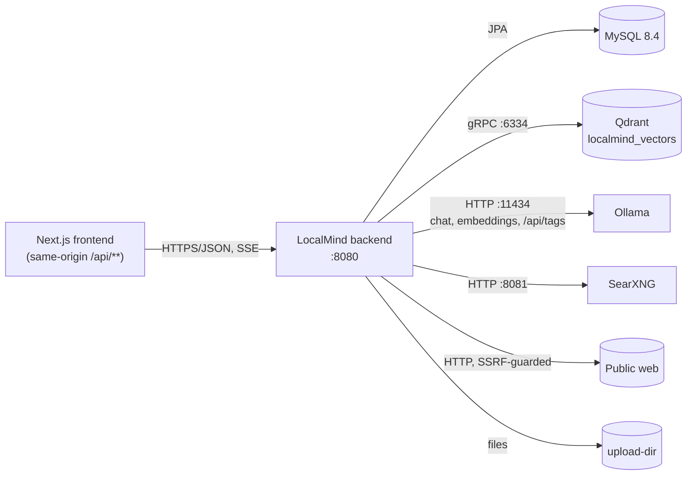
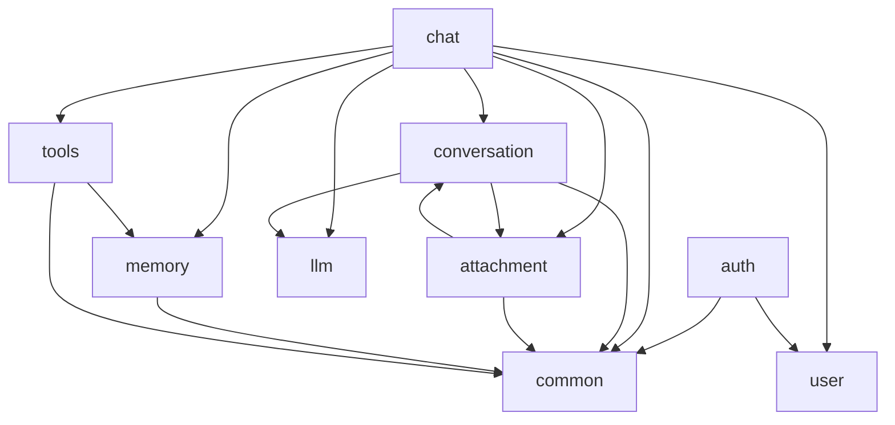

# Backend architecture

The backend is a Spring Boot 4.1 application (Java, Spring AI with Ollama and Qdrant, Spring Data JPA on MySQL)
organised **by feature**. This page explains how the pieces fit together at runtime. For the reasons behind the
design, see [DESIGN.md](../DESIGN.md); for the coding rules, see [AGENTS.md](../../AGENTS.md).

## Runtime context

| Dependency | Used for | Accessed through |
| --- | --- | --- |
| MySQL | Users, refresh tokens, conversations, messages, attachments, memories | Spring Data JPA repositories |
| Qdrant | Document chunks and memory embeddings, one collection | Spring AI `VectorStore`, `QdrantClient` for indexes |
| Ollama | Chat completions (streaming, tool calls), embeddings, model list | Spring AI `ChatClient`/`EmbeddingModel`, `shortTimeoutRestClient` |
| SearXNG | Web search tool | `shortTimeoutRestClient` |
| Local disk | Uploaded files | `FileStorageService` (`LocalDiskStorageService`) |

## Features

| Feature | Owns | Page |
| --- | --- | --- |
| `auth` | Register, login, token refresh, logout, profile; refresh tokens | [auth.md](features/auth.md) |
| `user` | `User` entity and repository | [user.md](features/user.md) |
| `conversation` | Conversations, messages, ownership guard, auto titles, summaries | [conversation.md](features/conversation.md) |
| `chat` | Streaming chat orchestration, SSE events, prompt advisors, tool selection | [chat.md](features/chat.md) |
| `attachment` | Uploads, file storage, document ETL into Qdrant | [attachment.md](features/attachment.md) |
| `memory` | Long-term user memories (list, pin, delete) | [memory.md](features/memory.md) |
| `llm` | Model catalogue (`/api/models`) and model profiles | [llm.md](features/llm.md) |
| `tools` | LLM-callable tools (date/time, math, document search, memory, web search, scraper) | [tools.md](features/tools.md) |
| `common` | Security, errors, transaction hooks, vector conventions, HTTP clients | [common.md](features/common.md) |

Inside each feature, classes sit in layer sub-packages (`controller`, `service`, `repository`, `entity`, `dto`,
`model`, `config`) plus at most one purpose-named package (`chat/prompt`, `attachment/storage`). `chat/prompt`
keeps its `PromptAdvisor` contract at the root and splits the rest by role: `advisor/` (the five pipeline steps),
`history/` (history trimming) and `token/` (token estimation).

### Dependencies between features

Derived from the imports in `src/main/java`. An arrow means "uses entities, repositories or services of". No feature
imports another feature's controllers.

`conversation` and `attachment` depend on each other: a conversation delete removes its attachments, and the
attachment feature checks conversation ownership.

## Request lifecycle

1. **Security filter chain** (`SecurityConfig`): CORS, then bearer-token validation with the local RSA public key.
   Register, login, refresh, logout, `/error` and `/actuator/health` are public. A missing or invalid token is answered with a 401
   `ProblemDetail` by `ProblemDetailSecurityHandler`.
2. **Controller**: binds and validates the DTO (`@Valid`), resolves the caller with `@CurrentUserId` (the JWT `userId`
   claim) and calls one service method.
3. **Service** (`@Transactional`): checks ownership (`OwnershipGuard` → 403 on mismatch), applies business rules,
   persists, and maps entities to response DTOs. Side effects outside MySQL are registered with `TransactionHooks`.
4. **Commit**: after-commit hooks start `@Async` jobs (document ETL, titles, summaries) or delete files and vectors.
   On rollback, hooks undo work already done outside the database (for example deleting a just-stored upload).
5. **Response**: the DTO is serialised as JSON. Any exception becomes a `ProblemDetail` via
   `GlobalExceptionHandler` (see [errors.md](errors.md)).

Chat requests differ after step 2: the controller returns an SSE stream and the `ChatTurn` that
`ChatOrchestratorService` creates keeps working after the servlet thread is released. See [flows/chat-streaming.md](flows/chat-streaming.md).

## Concurrency model

- Virtual threads are enabled (`spring.threads.virtual.enabled: true`) for request handling and Spring's default
  `@Async` executor. There is no custom executor.
- `@Async` jobs: `DocumentEtlService` (ingestion), `AutoTitleService` (conversation titles),
  `ConversationSummaryService` (rolling summaries). Each is triggered after commit.
- Scheduled jobs (`@EnableScheduling`): `RefreshTokenCleanupScheduler` calls `RefreshTokenCleanupService` (transactional) every hour to delete expired refresh tokens.
- Startup (`ApplicationReadyEvent`): `InterruptedIngestionRecovery` marks attachments left `PROCESSING` by a restart
  as `FAILED`. The model catalogue is loaded earlier, in `ModelCatalogService`'s `@PostConstruct`.
- Code running outside the request transaction (end of a stream, `@Async` jobs) never saves an entity it loaded
  earlier. It uses targeted `@Modifying` updates of the columns it owns (`ConversationRepository#touch`,
  `#replacePlaceholderTitle`, `#updateSummary`) so concurrent user edits are not overwritten.
- Async MVC requests (SSE) time out after 3 minutes (`WebMvcConfig`).

## Data stores

See [data-model.md](data-model.md) for tables, relations and vector payloads.

## Main flows

| Flow | Page |
| --- | --- |
| Register, login, refresh, logout | [flows/auth-session.md](flows/auth-session.md) |
| Sending a message and streaming the answer | [flows/chat-streaming.md](flows/chat-streaming.md) |
| Uploading a document and making it searchable | [flows/document-ingestion.md](flows/document-ingestion.md) |
| Prompt assembly, advisor by advisor | [PROMPT_GENERATION_PROCESS.md](../PROMPT_GENERATION_PROCESS.md) |
