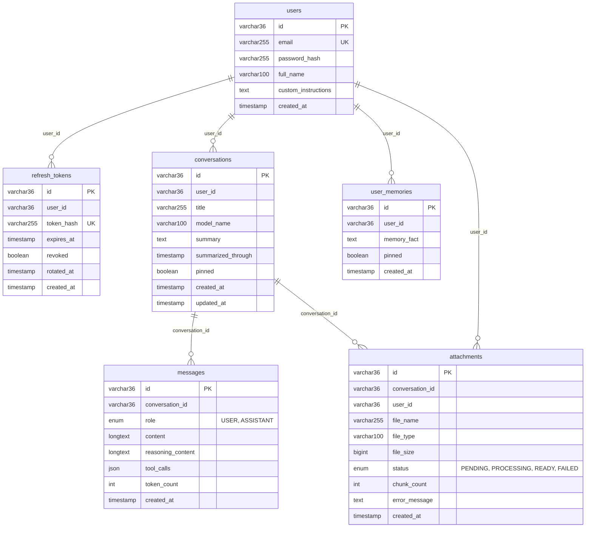

# Data model

LocalMind keeps relational data in MySQL, embeddings in one Qdrant collection, and uploaded files on local disk. Column
details, DTOs and per-table rules are on each feature page; this page shows how the stores fit together.

## Relational schema (MySQL)

The schema is generated by Hibernate (`spring.jpa.hibernate.ddl-auto`, default `update`); there are no migration
scripts. Entities declare **no JPA relations or foreign keys**: references between tables are plain `varchar(36)` UUID
columns, and cascading deletes are done by services.

### Indexes

Besides primary keys, every lookup column is indexed. The indexes are declared with `@Table(indexes = ...)`, and
Hibernate's schema update creates any that are missing, by name, on an existing database.

| Table | Index | Columns | Serves |
| --- | --- | --- | --- |
| `users` | unique | `email` | Login and registration lookups |
| `refresh_tokens` | unique | `token_hash` | Refresh and logout lookups |
| `refresh_tokens` | `idx_refresh_tokens_user` | `user_id` | Reuse detection deleting every token of a user |
| `refresh_tokens` | `idx_refresh_tokens_expires` | `expires_at` | Hourly cleanup of expired tokens |
| `conversations` | `idx_conversations_user_updated` | `user_id, updated_at` | Conversation list, newest first |
| `messages` | `idx_messages_conversation_created` | `conversation_id, created_at` | Thread view, prompt history, conversation delete |
| `attachments` | `idx_attachments_conversation_created` | `conversation_id, created_at` | Attachment list, `READY` check on every chat turn, conversation delete |
| `user_memories` | `idx_user_memories_user_created` | `user_id, created_at` | Memory vault, pinned memories on every chat turn |

Lookups by id plus owner (`existsByIdAndUserId`, `findByIdAndUserId`) use the primary key. `SchemaIndexTest` checks
that each index exists with its columns in order.



| Table | Entity | Feature page |
| --- | --- | --- |
| `users` | `User` | [user.md](features/user.md) |
| `refresh_tokens` | `RefreshToken` | [auth.md](features/auth.md#domain-model) |
| `conversations` | `Conversation` | [conversation.md](features/conversation.md#domain-model) |
| `messages` | `ChatMessage` | [conversation.md](features/conversation.md#domain-model) |
| `attachments` | `Attachment` | [attachment.md](features/attachment.md#domain-model) |
| `user_memories` | `UserMemory` | [memory.md](features/memory.md#domain-model) |

Ids are UUID strings set in `@PrePersist`, together with `created_at` (and `updated_at` for conversations).

## Vector store (Qdrant)

One collection (`localmind_vectors` by default), created by Spring AI with the embedding model's dimension. Two kinds
of points share it, distinguished by the `type` payload:

| `type` | Written by | Payload | Deleted when |
| --- | --- | --- | --- |
| `DOC_CHUNK` | `DocumentEtlService` (attachment ETL) | `userId`, `conversationId`, `attachmentId`, `fileName`, `chunkIndex` | The conversation is deleted (after commit) |
| `USER_MEMORY` | `UserMemoryTools.saveUserMemory` | `userId`, `memoryId` | The memory is deleted through `DELETE /api/memories/{id}` (after commit) |

Keyword payload indexes exist on `userId`, `conversationId`, `type` and `memoryId` (`QdrantConfig`). Searches always
use a [`VectorFilters`](features/common.md#vector-store-conventions) expression that includes the caller's `userId`.

| Reader | Filter | topK | Similarity threshold |
| --- | --- | --- | --- |
| `AutoRagAdvisor` | `documentChunks(userId, conversationId)` | 4 | 0.4 |
| `searchUploadedDocs` tool | `documentChunks(userId, conversationId)` | 4 | 0.4 |
| `MemoryRetrievalAdvisor` | `userMemories(userId)` | 5 | 0.4 |
| `recallUserMemories` tool | `userMemories(userId)` | 5 | 0.3 |

## File storage

Uploads are stored by `LocalDiskStorageService` at:

```text
<localmind.storage.upload-dir>/<userId>/<attachmentId>_<sanitised file name>
```

Files are written during the upload transaction (removed again on rollback) and deleted after a conversation delete
commits. See [attachment.md](features/attachment.md).

## Deletion and consistency

| Deleted | MySQL (same transaction) | After commit |
| --- | --- | --- |
| Conversation | Messages, attachments, conversation row | Attachment files, `DOC_CHUNK` vectors of the conversation |
| Memory | Memory row | Its `USER_MEMORY` vector |
| Refresh token | Logout deletes the row; rotated tokens are kept as revoked rows until they expire; reuse detection deletes all rows of the user | — |
| User | Not supported: no code path deletes a user | — |

`RefreshTokenCleanupService` deletes expired `refresh_tokens` rows every hour; see [auth.md](features/auth.md#business-rules).
