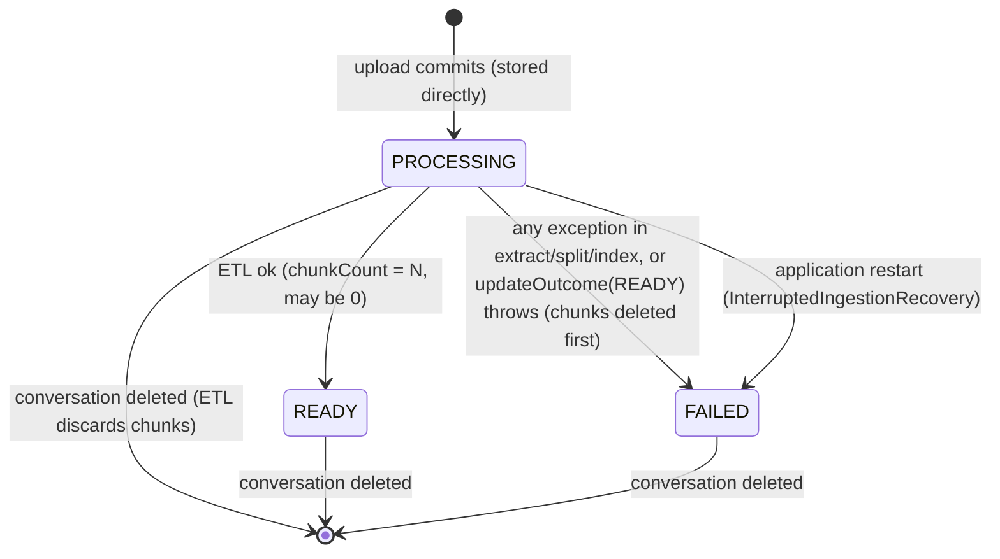

# Attachments (`com.localmind.attachment`)

Owns documents uploaded into a conversation: it validates and stores the original file on local disk, records it in the `attachments` table, and runs an asynchronous ETL job (Apache Tika → `TokenTextSplitter` → Qdrant) that turns the document into tenant-tagged `DOC_CHUNK` vectors. These chunks are what `AutoRagAdvisor` and the `searchUploadedDocs` tool retrieve (see [PROMPT_GENERATION_PROCESS.md](../../PROMPT_GENERATION_PROCESS.md)). The feature also provides the file download and the cleanup of files and vectors when a conversation is deleted.

## Responsibilities

- Accept multipart uploads into a conversation the caller owns (write-locking the conversation row so the upload cannot interleave with a conversation delete), check that the file is not empty, its size, the length of its name and its extension; derive the stored content type from the extension.
- Store the original bytes under `<uploadDir>/<userId>/<attachmentId>_<sanitizedName>`, protected against directory traversal.
- Persist the `Attachment` row with status `PROCESSING` and start the ETL job after commit. On rollback, delete the stored (possibly partly written) file.
- At startup, mark attachments left `PROCESSING` by a restart as `FAILED`.
- ETL: extract text with Tika (5,000,000 character cap), split it into 500-token chunks, add the tenant metadata, write the chunks to the vector store, then mark the attachment `READY` (with its chunk count) or, on any failure, delete the chunks of that attachment and mark it `FAILED` (with a fixed message).
- List a conversation's attachments and stream the original file back for download.
- Delete all attachment rows of a conversation; after commit, delete their files and the conversation's `DOC_CHUNK` vectors.

## Package layout

| Class | Layer | Role |
| --- | --- | --- |
| [`AttachmentController`](../../../backend/src/main/java/com/localmind/attachment/controller/AttachmentController.java) | controller | Upload, list, download endpoints under `/api/conversations/{conversationId}/attachments` |
| [`AttachmentService`](../../../backend/src/main/java/com/localmind/attachment/service/AttachmentService.java) | service | Upload validation, storage, row creation, transaction hooks, listing, download resolution (`AttachmentDownload`), conversation-wide delete |
| [`DocumentEtlService`](../../../backend/src/main/java/com/localmind/attachment/service/DocumentEtlService.java) | service | `@Async` Tika extraction, chunking, vector indexing, status update, chunk deletion |
| [`InterruptedIngestionRecovery`](../../../backend/src/main/java/com/localmind/attachment/service/InterruptedIngestionRecovery.java) | service | `ApplicationReadyEvent` listener: marks every `PROCESSING` attachment `FAILED` after a restart |
| [`AttachmentRepository`](../../../backend/src/main/java/com/localmind/attachment/repository/AttachmentRepository.java) | repository | Spring Data repository, derived queries, `@Transactional @Modifying` `updateOutcome`, `failAllWithStatus` and bulk delete by conversation (`deleteByConversationId`) |
| [`Attachment`](../../../backend/src/main/java/com/localmind/attachment/entity/Attachment.java) | entity | `attachments` row plus the `Status` enum |
| [`AttachmentResponse`](../../../backend/src/main/java/com/localmind/attachment/dto/AttachmentResponse.java) | dto | List item, built with `from(Attachment)` |
| [`UploadResponse`](../../../backend/src/main/java/com/localmind/attachment/dto/UploadResponse.java) | dto | `202` body of an upload |
| [`AttachmentDownload`](../../../backend/src/main/java/com/localmind/attachment/model/AttachmentDownload.java) | model | `(Resource resource, String fileName, String contentType)` returned by `AttachmentService#getAttachmentDownload` to the controller |
| [`SupportedFileType`](../../../backend/src/main/java/com/localmind/attachment/model/SupportedFileType.java) | model | Enum of ingestible types (`pdf`, `txt`, `docx`, `md`) with their content types: the single source of the default allowed extensions and the stored/served `Content-Type` |
| [`FileStorageProperties`](../../../backend/src/main/java/com/localmind/attachment/config/FileStorageProperties.java) | config | `localmind.storage.*`: upload dir, max size, allowed extensions (default `SupportedFileType.extensions()`; trimmed, lower-cased, blanks dropped; an extension that is not a `SupportedFileType` fails startup) |
| [`FileStorageService`](../../../backend/src/main/java/com/localmind/attachment/storage/FileStorageService.java) | storage | Storage abstraction: `store`, `loadAsResource`, `delete` keyed by `(userId, attachmentId, originalFileName)` |
| [`LocalDiskStorageService`](../../../backend/src/main/java/com/localmind/attachment/storage/LocalDiskStorageService.java) | storage | The only implementation: local disk, file-name sanitising, traversal guard |

## HTTP API

All endpoints need a Bearer JWT. The caller comes from `@CurrentUserId`.

| Method | Path | Request body | Response | Status | Notes |
| --- | --- | --- | --- | --- | --- |
| `POST` | `/api/conversations/{conversationId}/attachments` | `multipart/form-data`, part `file` | `UploadResponse` | `202 Accepted` | Ingestion continues in the background |
| `GET` | `/api/conversations/{conversationId}/attachments` | none | `AttachmentResponse[]` | `200 OK` | Newest first (`created_at DESC`), no pagination |
| `GET` | `/api/conversations/{conversationId}/attachments/{attachmentId}/download` | none | binary (`Resource`) | `200 OK` | `Content-Disposition: attachment`; `Content-Type` derived from the file extension (`SupportedFileType`); `X-Content-Type-Options: nosniff` |

The feature has no endpoint that deletes a single attachment. Attachments are deleted only through `DELETE /api/conversations/{id}` (conversation feature), which calls `AttachmentService#deleteConversationAttachments`.

### Upload

- Ownership comes first: `OwnershipGuard#lockOwnedConversation` loads the caller's conversation with a `PESSIMISTIC_WRITE` lock held until the upload transaction ends. If the conversation is missing or not the caller's, the response is `403` before the file is inspected. A conversation delete takes the same lock, so an upload that waited for a concurrent delete fails here with `403` instead of storing a row, file and chunks for a deleted conversation.
- Validation checks run in this order:
  1. The file is missing or empty.
  2. `size > localmind.storage.max-file-size`.
  3. The original file name (or `"unnamed"`, `Attachment.UNNAMED_FILE_NAME`) is longer than 255 characters (`MAX_FILE_NAME_LENGTH`, the length of `file_name`).
  4. The extension is not in `allowed-extensions`.
- Extension: the text after the last `.` of the original name. A name with no dot, a leading dot only (`.md`) or a trailing dot gets `""`, which is rejected. The uploaded extension is lower-cased; the configured list is trimmed and lower-cased by `FileStorageProperties`, so the match is case-insensitive.
- Spring multipart limits (`spring.servlet.multipart.max-file-size` 25MB, `max-request-size` 30MB) apply before the controller runs. An over-limit request fails in Spring MVC (`MaxUploadSizeExceededException`, rendered by `ResponseEntityExceptionHandler` as `413` with Spring's default detail) and never reaches the service's own size check. Both size limits read `UPLOAD_MAX_FILE_SIZE`.
- `fileName` in the database and in responses is the unsanitised `MultipartFile#getOriginalFilename()`, or `"unnamed"` when it is null. Only the name on disk is sanitised. `fileType` is derived from the extension (case-insensitive) through `SupportedFileType`: `pdf` → `application/pdf`, `txt` → `text/plain`, `md` → `text/markdown`, `docx` → `application/vnd.openxmlformats-officedocument.wordprocessingml.document`. Every allowed extension is a `SupportedFileType` (checked at startup); `application/octet-stream` is only the fallback for rows whose name has no supported extension. The client's `Content-Type` is never used.
- The response `status` is always `"PROCESSING"`.

### Download

- `OwnershipGuard#validateConversationOwnership` runs first (`403`). The row is then loaded with `findById(attachmentId)`; an
  unknown id, another user's attachment and an attachment of another conversation are all `403` (`AccessDeniedException`,
  `"Access denied: Attachment does not belong to this conversation"`, logged only), so attachment ids cannot be probed.
- `AttachmentService#getAttachmentDownload` returns an `AttachmentDownload` (resource, file name, content type); the controller only sets the headers.
- The file can be downloaded in any status (`PROCESSING`/`FAILED` included).
- `Content-Disposition`: `attachment; filename*=UTF-8''…` built from the stored `fileName`. `Content-Type` is `AttachmentDownload#contentType`: the same `SupportedFileType` mapping as on upload, applied to `fileName`. The stored `fileType` is not used, because rows stored before types were derived on the server may hold a client-supplied type.
- `X-Content-Type-Options: nosniff` stops browsers from sniffing a different type.
- A missing or unreadable file on disk returns `404 File not found` (attachment id logged at `warn`).

### Response examples

`UploadResponse`:

```json
{ "attachmentId": "3f0c…-uuid", "status": "PROCESSING", "fileName": "guide.pdf", "fileSize": 482113 }
```

`AttachmentResponse` (list item):

```json
{
  "id": "3f0c…-uuid",
  "conversationId": "9a1b…-uuid",
  "userId": "57de…-uuid",
  "fileName": "guide.pdf",
  "fileType": "application/pdf",
  "fileSize": 482113,
  "status": "READY",
  "chunkCount": 37,
  "errorMessage": null,
  "createdAt": "2026-11-16T10:15:30.123Z"
}
```

## Domain model

### Entity `Attachment` → table `attachments`

| Column | Java type | Constraints | Default |
| --- | --- | --- | --- |
| `id` | `String` | PK, length 36, not null | `@PrePersist`: random UUID if null (the upload assigns its own UUID beforehand) |
| `conversation_id` | `String` | length 36, not null | none |
| `user_id` | `String` | length 36, not null | none |
| `file_name` | `String` | length 255, not null | none |
| `file_type` | `String` | length 100 | none |
| `file_size` | `Long` | none | none |
| `status` | `Status` (`@Enumerated(STRING)`) | not null | `@Builder.Default` `PROCESSING` |
| `chunk_count` | `Integer` | none | `@Builder.Default` `0` |
| `error_message` | `String` | `TEXT` | none |
| `created_at` | `Instant` | `updatable = false` | `@PrePersist`: `Instant.now()` if null |

- Relations: none mapped. `conversation_id` and `user_id` are plain strings, with no JPA association and no FK annotation. Index `idx_attachments_conversation_created` (`conversation_id, created_at`).
- Processing results are written with `AttachmentRepository#updateOutcome(id, status, chunkCount, errorMessage)`, a targeted `@Modifying` `UPDATE` of those three columns that returns the number of rows updated.
- `AttachmentRepository#failAllWithStatus(status, failed, errorMessage)` (`@Transactional @Modifying`) sets `status = failed` and `error_message` on every row still in `status` and returns the count; `chunk_count` is left unchanged.

### Status lifecycle



- Nothing retries a `FAILED` attachment.
- The ETL job runs in memory, so a restart abandons it. On `ApplicationReadyEvent`, `InterruptedIngestionRecovery#failInterruptedIngestions` calls `AttachmentRepository#failAllWithStatus(PROCESSING, FAILED, INTERRUPTED_MESSAGE)`, setting `errorMessage` to `Processing was interrupted by a server restart. Please upload the file again.` LocalMind runs as a single instance, so no job can be running at that moment.

### DTOs

| Record | Fields | Validation |
| --- | --- | --- |
| `UploadResponse` | `attachmentId: String`, `status: String`, `fileName: String`, `fileSize: Long` | none (response) |
| `AttachmentResponse` | `id`, `conversationId`, `userId`, `fileName`, `fileType: String`; `fileSize: Long`; `status: String` (enum name or null); `chunkCount: Integer`; `errorMessage: String`; `createdAt: Instant` | none (response) |

There is no request DTO. The upload is a `MultipartFile` `@RequestParam("file")`.

## Business rules

1. Every endpoint first checks conversation ownership: the upload with `OwnershipGuard.lockOwnedConversation(conversationId, userId)` (write lock until commit), list and download with `OwnershipGuard.validateConversationOwnership(conversationId, userId)`.
2. Upload validation, in order:
   - the file is non-null and non-empty;
   - `size <= maxFileSize`;
   - the original file name (or `"unnamed"`, `Attachment.UNNAMED_FILE_NAME`) is at most 255 characters;
   - the extension (after the last dot, `dot > 0` and not the last character) is in `allowedExtensions`, compared case-insensitively (uploaded extension lower-cased, configured list normalised at binding).
3. The attachment id is a fresh UUID generated in the service. The transaction hooks are registered first, then the file is written to disk, then the row is saved.
4. Path on disk: `<rootLocation>/<userId>/<attachmentId>_<sanitizedName>`. `rootLocation` is `Paths.get(uploadDir).toAbsolutePath().normalize()`, computed from `FileStorageProperties` on each call.
5. File-name sanitising (`LocalDiskStorageService#sanitizeFileName`):
   - a null name becomes `"unnamed"` (`Attachment.UNNAMED_FILE_NAME`);
   - the name is reduced to its last path segment (`Paths.get(name).getFileName()`); a name the OS cannot parse (e.g. containing NUL) or without a segment (e.g. `/`) is kept whole instead of failing with a 500, since the next step replaces every separator and unsafe character;
   - every character outside `[a-zA-Z0-9._-]` becomes `_`;
   - a blank result becomes `"attachment"`.
6. Traversal guard:
   - a blank `userId` or `attachmentId` throws `IllegalArgumentException`;
   - the normalised user directory must start with `rootLocation`, and the target must start with the user directory. Otherwise `SecurityException` is thrown.
7. `store` creates the parent directories and overwrites an existing file (`REPLACE_EXISTING`).
8. The row is saved with status `PROCESSING`, `fileType` derived from the extension (never `file.getContentType()`) and `fileSize = file.getSize()`.
9. Download lookup is by id: an unknown id, another user's attachment or another conversation's attachment → 403.
10. Listing returns every attachment of the conversation ordered by `createdAt` descending.
11. Delete happens only per conversation (`deleteConversationAttachments`):
    - if the conversation has no attachments, the method returns without doing anything;
    - otherwise the rows are bulk-deleted (`@Transactional @Modifying` JPQL, joining the caller's transaction);
    - after commit, each stored file is deleted, then `DOC_CHUNK` vectors are deleted once per distinct `userId` with `VectorFilters.documentChunks(userId, conversationId)`.
12. ETL, when the job finds the row:
    - if the extracted text is null or blank, the attachment becomes `READY` with `chunkCount = 0` and nothing is written to Qdrant;
    - otherwise the chunks are added and the attachment becomes `READY` with `chunkCount = chunks.size()`.
13. ETL failure: any `Exception` (including a `vectorStore.add` that wrote only some chunks, or `updateOutcome(READY)` throwing) is logged with details. The job then deletes the chunks of this attachment (`userId == u AND attachmentId == a AND type == DOC_CHUNK`), because `AutoRagAdvisor` retrieves every chunk of the conversation once any attachment is `READY`, and records `FAILED` with `chunkCount = 0` and the fixed message `"The document could not be processed. Check that the file is a valid, unencrypted document and upload it again."`. Recording `FAILED` is guarded: if it throws too (e.g. the database is down), the error is logged and the row stays `PROCESSING` until `InterruptedIngestionRecovery` fails it at the next start. The job never rethrows.
14. ETL racing a delete: the result is written with a targeted `UPDATE`, which cannot re-insert a deleted row. If it updates 0 rows, the job deletes the chunks of that attachment it may have just written.
15. Upload racing a conversation delete: both lock the conversation row first (`ConversationRepository#findLockedByIdAndUserId`, `PESSIMISTIC_WRITE`). Either the upload commits first and the delete then finds and removes its row, file and chunks, or the delete commits first and the upload's locked lookup finds nothing and fails with `403`.

## Side effects & async work

| Trigger | Effect |
| --- | --- |
| Upload transaction commits (`TransactionHooks.onOutcome`, commit branch) | `documentEtlService.processAttachment(attachmentId)`. The call goes through the Spring proxy, so it runs `@Async` |
| Upload transaction rolls back (`onOutcome`, rollback branch) | `fileStorageService.delete(userId, attachmentId, fileName)` removes the already-written file |
| Conversation delete commits (`TransactionHooks.afterCommit`) | Deletes every attachment file, then `vectorStore.delete(VectorFilters.documentChunks(userId, conversationId))` per distinct user |

- The hook is registered **before** `storeFile` runs, so a failure while the file is being written (`IllegalStateException`/`UncheckedIOException`) rolls back the transaction and the rollback branch deletes the partly written file.
- `InterruptedIngestionRecovery` runs once on `ApplicationReadyEvent` (not in a request transaction): one bulk `failAllWithStatus` update, logging the count at `warn` when it is above 0. Any `RuntimeException` is logged at `warn` and swallowed, so startup is never blocked.
- Hook callbacks never throw: `TransactionHooks` logs any failure. `FileStorageService#delete`, `DocumentEtlService#deleteIndexedChunks` and the per-attachment chunk delete of the ETL job also only log, never throw.

### `@Async processAttachment`

- Runs on Spring Boot's default `applicationTaskExecutor`. `@EnableAsync` is on `LocalMindApplication`, and `spring.threads.virtual.enabled: true` makes that executor use virtual threads. There is no custom executor.
- It loads the row with `findById`. If the row is missing, it logs a warning and returns.

### Tika extraction

- `new Tika()` with `setMaxStringLength(5_000_000)`, then `tika.parseToString(InputStream)` on the stored file.
- Longer documents are truncated to the cap, which guards against decompression bombs.

### Splitter

`TokenTextSplitter.builder()` settings:

| Setting | Value |
| --- | --- |
| `chunkSize` | 500 (tokens) |
| `minChunkSizeChars` | 50 |
| `minChunkLengthToEmbed` | 10 |
| `maxNumChunks` | 5000 |
| `keepSeparator` | `true` |

### Qdrant write

- One `vectorStore.add(chunks)` call. Embeddings are computed by the Spring AI vector store with the Ollama embedding model.
- Metadata on every chunk:

| `VectorMetadata` key | Value |
| --- | --- |
| `USER_ID` (`userId`) | attachment's `userId` |
| `CONVERSATION_ID` (`conversationId`) | attachment's `conversationId` |
| `ATTACHMENT_ID` (`attachmentId`) | attachment id |
| `FILE_NAME` (`fileName`) | stored (unsanitised) `fileName` |
| `TYPE` (`type`) | `TYPE_DOC_CHUNK` = `"DOC_CHUNK"` |
| `CHUNK_INDEX` (`chunkIndex`) | 0-based position in the split |

### Status write

- The job never saves the entity it loaded earlier. It calls `attachmentRepository.updateOutcome(...)` (own `@Transactional`), which only touches `status`, `chunk_count` and `error_message`.

### Qdrant delete

- Conversation delete: `vectorStore.delete(Filter.Expression)` with `VectorFilters.documentChunks` (`userId == u AND conversationId == c AND type == DOC_CHUNK`), removing the chunks of the whole conversation for that user.
- ETL failure, or an attachment deleted during processing: `userId == u AND attachmentId == a AND type == DOC_CHUNK`, built by `DocumentEtlService#attachmentChunks` from the same `VectorMetadata` keys written on ingest (there is no `VectorFilters` method for it yet).

### Qdrant reads

- None in this feature. `AutoRagAdvisor` and `DocumentSearchTools` read these chunks.

### External HTTP

- None directly. Qdrant is reached through gRPC and Ollama embeddings through Spring AI.

## Configuration

| Property | Env var | Default | Effect |
| --- | --- | --- | --- |
| `localmind.storage.upload-dir` | `UPLOAD_DIR` | `./uploads` | Root directory of stored files, resolved to an absolute, normalised path at startup |
| `localmind.storage.max-file-size` | `UPLOAD_MAX_FILE_SIZE` | `25MB` (record default `DataSize.ofMegabytes(25)`) | Service-side size limit. The error message shows `toMegabytes()`, which is truncated to whole MB |
| `localmind.storage.allowed-extensions` | `UPLOAD_ALLOWED_EXTENSIONS` | `pdf,txt,docx,md` | Accepted extensions; the record default is `SupportedFileType.extensions()`. The record trims and lower-cases each configured value and drops blank ones; uploaded extensions are lower-cased (`Locale.ROOT`) before matching. A value that is not a `SupportedFileType` (`pdf`, `txt`, `docx`, `md`) fails startup with `IllegalArgumentException` |
| `spring.servlet.multipart.max-file-size` | `UPLOAD_MAX_FILE_SIZE` | `25MB` | Spring multipart limit per file (read by Spring, shares the env var) |
| `spring.servlet.multipart.max-request-size` | `UPLOAD_MAX_REQUEST_SIZE` | `30MB` | Spring multipart limit per request |

## Errors

| Situation | Exception | HTTP status | Client message |
| --- | --- | --- | --- |
| Conversation not owned / not found (upload: also when deleted while the upload waited for the lock) | `AccessDeniedException` (`OwnershipGuard`) | 403 | `You do not have access to this resource` |
| Empty or missing upload content | `BadRequestException` | 400 | `Uploaded file must not be empty` |
| File larger than `max-file-size` (service check) | `BadRequestException` | 400 | `File exceeds maximum size limit of <N>MB` |
| Original file name longer than 255 characters | `BadRequestException` | 400 | `File name must not exceed 255 characters` |
| Extension not allowed | `BadRequestException` | 400 | `Unsupported file format '<ext>'. Allowed: [pdf, txt, docx, md]` (list printed with `List#toString`) |
| Multipart part `file` absent | `MissingServletRequestPartException` (Spring) | 400 | Spring default detail |
| Request over the Spring multipart limits | `MaxUploadSizeExceededException` (Spring) | 413 | Spring default detail |
| Attachment id unknown, another user's, or of another conversation (download) | `AccessDeniedException` (`"Access denied: Attachment does not belong to this conversation"`, logged only) | 403 | `You do not have access to this resource` |
| Stored file missing or unreadable on download | `ResourceNotFoundException` (`LocalDiskStorageService`) | 404 | `File not found` (attachment id logged at `warn`) |
| Malformed file URI | `ResourceNotFoundException` | 404 | `Invalid file path URI` |
| Upload stream cannot be read | `UncheckedIOException` | 500 | `An unexpected error occurred. Please try again.` |
| Writing to disk fails | `IllegalStateException` (`Failed to store file: …`, logged only) | 500 | `An unexpected error occurred. Please try again.` |
| Blank user or attachment id in storage | `IllegalArgumentException` | 500 | `An unexpected error occurred. Please try again.` |
| Traversal detected | `SecurityException` | 500 | `An unexpected error occurred. Please try again.` |
| ETL failure (async, not an HTTP error) | caught, chunks of the attachment deleted, `updateOutcome(FAILED)` (itself guarded: a failure is logged and the row stays `PROCESSING` until restart) | none | Stored `errorMessage`: `The document could not be processed. Check that the file is a valid, unencrypted document and upload it again.` |
| Attachment still `PROCESSING` at startup (not an HTTP error) | `failAllWithStatus` | none | Stored `errorMessage`: `Processing was interrupted by a server restart. Please upload the file again.` |
| `allowed-extensions` contains an unsupported extension | `IllegalArgumentException` at binding | none (startup fails) | none |

## Interactions with other features

### Calls into other features

| Calls | Why |
| --- | --- |
| `conversation.service.OwnershipGuard` | Ownership check on every endpoint; `lockOwnedConversation` on upload |
| `common.transaction.TransactionHooks` | After-commit ETL trigger, rollback cleanup and after-commit delete cleanup |
| `common.ai.VectorMetadata` / `VectorFilters` | Chunk metadata, the conversation delete filter, and the keys of the per-attachment delete filter |
| Spring AI `VectorStore` | Qdrant, configured in `common.config` |

### Called by

| Caller | Uses |
| --- | --- |
| `conversation.service.ConversationService#deleteConversation` | Calls `AttachmentService#deleteConversationAttachments` inside its transaction, before it deletes messages and the conversation |
| `chat.prompt.advisor.AutoRagAdvisor` | `AttachmentRepository#existsByConversationIdAndStatus(conversationId, READY)` to decide whether to retrieve document chunks |
| `chat.service.ToolSelector` | The same query, to decide whether to offer `searchUploadedDocs` |

## Tests

| Test class | What it covers |
| --- | --- |
| [`AttachmentControllerTest`](../../../backend/src/test/java/com/localmind/attachment/controller/AttachmentControllerTest.java) | `@SpringBootTest` + MockMvc: upload `202`/`PROCESSING`, empty file `400`, disallowed extension `400` with its message and no row, cross-tenant upload `403`, list with status and chunk count, download body, `Content-Disposition`, `Content-Type` from the extension (`text/plain` although the stored `fileType` is `text/html`) and `X-Content-Type-Options: nosniff`; download through another user's conversation `403`, of another user's attachment through the caller's conversation `403`, of the caller's attachment through another of their conversations `403`, of an unknown id `403` |
| [`AttachmentServiceTest`](../../../backend/src/test/java/com/localmind/attachment/service/AttachmentServiceTest.java) | `deleteConversationAttachments` deletes rows, files and chunks (per user), and does nothing for an empty conversation; upload takes the conversation lock (`lockOwnedConversation`), and a missing conversation is rejected before anything is stored; upload rejects a 256-character file name, a disallowed extension and a file over `max-file-size` with 400 without saving; stored `fileType` is derived from the extension (`Notes.PDF` → `application/pdf`) whatever the client sends; a store failure followed by rollback deletes the partly stored file and never starts the ETL; `getAttachmentDownload` returns resource, name and `text/markdown` for `Guide.MD`, `403` for an unknown id, another conversation or another user's attachment |
| [`InterruptedIngestionRecoveryTest`](../../../backend/src/test/java/com/localmind/attachment/service/InterruptedIngestionRecoveryTest.java) | `failInterruptedIngestions` calls `failAllWithStatus(PROCESSING, FAILED, INTERRUPTED_MESSAGE)`; a database failure is swallowed so startup continues |
| [`FileStoragePropertiesTest`](../../../backend/src/test/java/com/localmind/attachment/config/FileStoragePropertiesTest.java) | Configured extensions trimmed and lower-cased, blank entries dropped; `isAllowedExtension` case-insensitive; default equals `SupportedFileType.extensions()`; an unsupported extension fails construction |
| [`DocumentEtlServiceTest`](../../../backend/src/test/java/com/localmind/attachment/service/DocumentEtlServiceTest.java) | Successful ETL writes every metadata key and records `READY` with the chunk count via `updateOutcome`; an I/O failure records `FAILED` without indexing; a row deleted during processing is never saved and its chunks are deleted; a partly failed `vectorStore.add` and a failing `READY` update both delete the attachment's chunks and record `FAILED`; a failing `FAILED` update is swallowed; the per-attachment filter is scoped to user, attachment and `DOC_CHUNK` |
| [`LocalDiskStorageServiceTest`](../../../backend/src/test/java/com/localmind/attachment/storage/LocalDiskStorageServiceTest.java) | `LocalDiskStorageService` store/load round trip, delete, and `../../secret.txt` reduced to `att-evil_secret.txt` inside the user directory; names with NUL, `/` or `../` segments are stored inside the user's directory |
| [`ConversationServiceTest`](../../../backend/src/test/java/com/localmind/conversation/service/ConversationServiceTest.java) (conversation) | A conversation delete runs the real `deleteConversationAttachments`: rows, stored files and chunks are removed |
| [`RepositoryPersistenceTests`](../../../backend/src/test/java/com/localmind/integration/RepositoryPersistenceTests.java) (integration) | Persistence of the `Attachment` status enum, chunk count and ordering by conversation; `updateOutcome` updates only the ETL columns and updates 0 rows after a delete; `failAllWithStatus` changes only rows still `PROCESSING` |
