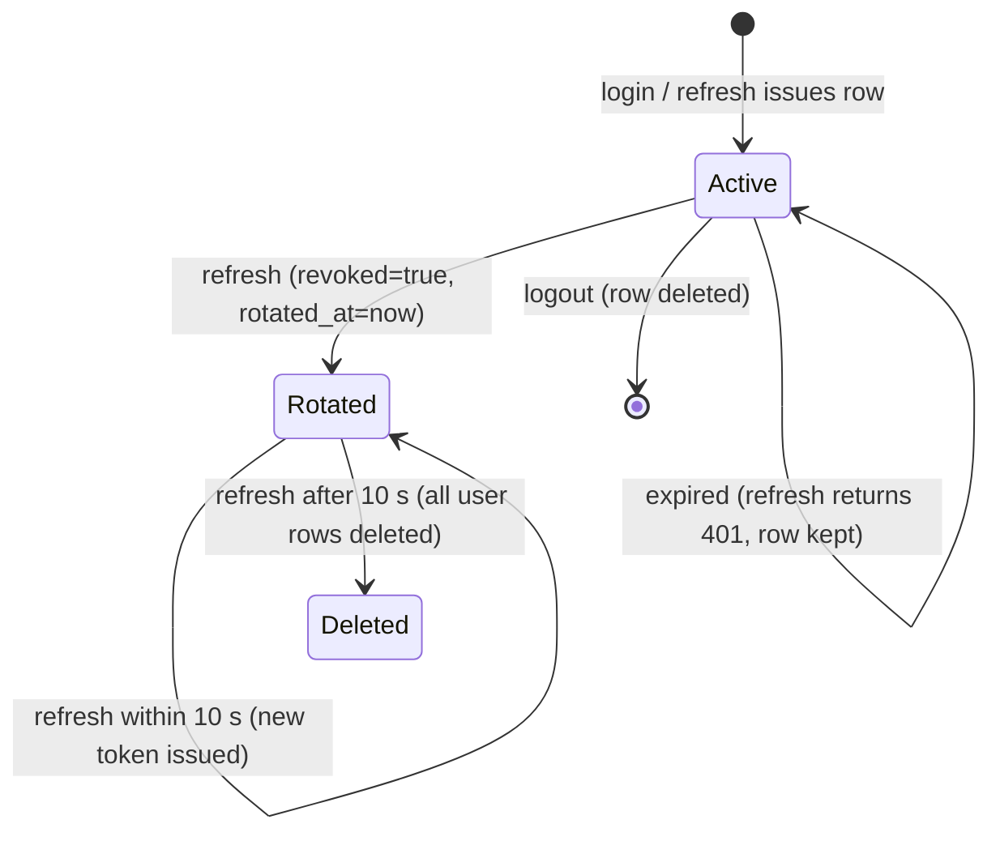

# Auth (`com.localmind.auth`)

Owns account registration, password login, the access-token / refresh-token session protocol and the caller's own
profile (`/api/auth/**`). It issues RS256 access tokens that every other feature trusts through the Spring Security
resource server and `@CurrentUserId`, and keeps opaque, rotating refresh tokens in the `refresh_tokens` table so a
browser session survives the short access-token lifetime without exposing a long-lived token to JavaScript. Design
rationale is in [DESIGN.md section 4.1](../../DESIGN.md); this page documents the code.

## Responsibilities

- Register users: normalise email, enforce password limits, BCrypt-hash the password, reject duplicate emails.
- Authenticate email + password and issue an access token (JSON body) plus a refresh token (HttpOnly cookie).
- Rotate refresh tokens on every refresh, detect replay of revoked tokens and revoke all of the user's sessions.
- Revoke the presented refresh token on logout and expire the cookie.
- Read and update the caller's profile (`fullName`, `customInstructions`).
- Build the signed JWT (claims, lifetime). Signature validation, the signing key and the security filter chain live in
  `common.security` (`SecurityConfig`, `JwtSigningKeyStore`, `JwtProperties`), not in this feature.

## Package layout

| Class | Layer | Role |
| --- | --- | --- |
| [`AuthController`](../../../backend/src/main/java/com/localmind/auth/controller/AuthController.java) | controller | `/api/auth` endpoints; sets/clears the refresh cookie via `Set-Cookie` |
| [`AuthService`](../../../backend/src/main/java/com/localmind/auth/service/AuthService.java) | service | Register, login, refresh rotation + reuse detection, logout, profile read/update |
| [`RefreshTokenCleanupService`](../../../backend/src/main/java/com/localmind/auth/service/RefreshTokenCleanupService.java) | service | Hourly `@Scheduled` delete of expired refresh tokens |
| [`JwtService`](../../../backend/src/main/java/com/localmind/auth/service/JwtService.java) | service | Builds and signs the access token through the `JwtEncoder` bean; issuer `SecurityConfig.TOKEN_ISSUER` |
| [`RefreshTokenCookieFactory`](../../../backend/src/main/java/com/localmind/auth/service/RefreshTokenCookieFactory.java) | service | Builds the `refreshToken` cookie (create / expire) from `JwtProperties` |
| [`RefreshTokenRepository`](../../../backend/src/main/java/com/localmind/auth/repository/RefreshTokenRepository.java) | repository | Lookup by hash (plain and `PESSIMISTIC_WRITE`), bulk delete by user |
| [`RefreshToken`](../../../backend/src/main/java/com/localmind/auth/entity/RefreshToken.java) | entity | `refresh_tokens` row; `rotate()`, `isExpired()`, `isRecentlyRotated()` |
| [`RegisterRequest`](../../../backend/src/main/java/com/localmind/auth/dto/RegisterRequest.java) | dto | Registration body |
| [`LoginRequest`](../../../backend/src/main/java/com/localmind/auth/dto/LoginRequest.java) | dto | Login body |
| [`UpdateProfileRequest`](../../../backend/src/main/java/com/localmind/auth/dto/UpdateProfileRequest.java) | dto | Profile patch body |
| [`AuthResponse`](../../../backend/src/main/java/com/localmind/auth/dto/AuthResponse.java) | dto | Login response: access token + user |
| [`RefreshTokenResponse`](../../../backend/src/main/java/com/localmind/auth/dto/RefreshTokenResponse.java) | dto | Refresh response: access token only |
| [`UserSummary`](../../../backend/src/main/java/com/localmind/auth/dto/UserSummary.java) | dto | Public view of a `User` (`from(User)`) |
| [`LoginResult`](../../../backend/src/main/java/com/localmind/auth/model/LoginResult.java) | model | `AuthResponse` + raw refresh token handed from service to controller |
| [`RefreshResult`](../../../backend/src/main/java/com/localmind/auth/model/RefreshResult.java) | model | `RefreshTokenResponse` + new raw refresh token |

## HTTP API

`register`, `login`, `refresh` and `logout` are listed one by one in `SecurityConfig.PUBLIC_PATHS` (`permitAll`).
`/api/auth/me` is not, so the filter chain requires a valid bearer token for it like any other protected endpoint.

| Method | Path | Request body | Response | Status | Notes |
| --- | --- | --- | --- | --- | --- |
| `POST` | `/api/auth/register` | `RegisterRequest` | `UserSummary` | 201 | No token or cookie issued; client must log in |
| `POST` | `/api/auth/login` | `LoginRequest` | `AuthResponse` | 200 | `Set-Cookie: refreshToken=...` |
| `POST` | `/api/auth/refresh` | none (cookie `refreshToken`) | `RefreshTokenResponse` | 200 | Rotates the cookie (`Set-Cookie`) |
| `POST` | `/api/auth/logout` | none (cookie `refreshToken`) | empty | 204 | Always 204; always sends an expired cookie |
| `GET` | `/api/auth/me` | none | `UserSummary` | 200 | `Authorization: Bearer <access token>` |
| `PATCH` | `/api/auth/me` | `UpdateProfileRequest` | `UserSummary` | 200 | `Authorization: Bearer <access token>` |

### Register

- Email is trimmed and lower-cased (`Locale.ROOT`) before the duplicate check and storage; `fullName` is trimmed.
- Password: 8 to 72 characters (Bean Validation) and at most 72 UTF-8 bytes (service check, because BCrypt ignores
  bytes beyond 72). No complexity rules. Hashed with `BCryptPasswordEncoder` (default strength 10).

```json
{ "email": "ada@example.com", "password": "correct horse", "fullName": "Ada Lovelace" }
```

Response (`UserSummary`):

```json
{
  "id": "6f1c1f0e-2b7a-4f0e-9a51-3c1d2e4f5a6b",
  "email": "ada@example.com",
  "fullName": "Ada Lovelace",
  "customInstructions": null,
  "createdAt": "2026-11-16T09:30:00Z"
}
```

### Login

- Email normalised as above; unknown email and wrong password give the same 401 message.
- Exactly one BCrypt check runs either way: against the user's hash, or against a dummy hash (BCrypt of a random
  UUID, created lazily on first use through a `SingletonSupplier`) when the email is unknown, so response times do not
  reveal which emails are registered.
- Creates a new refresh-token row (existing sessions of the user are kept: one row per login).

```json
{ "email": "ada@example.com", "password": "correct horse" }
```

Response (`AuthResponse`; `expiresIn` is the access-token lifetime in seconds):

```json
{
  "accessToken": "eyJraWQiOiI...",
  "tokenType": "Bearer",
  "expiresIn": 900,
  "user": {
    "id": "6f1c1f0e-2b7a-4f0e-9a51-3c1d2e4f5a6b",
    "email": "ada@example.com",
    "fullName": "Ada Lovelace",
    "customInstructions": null,
    "createdAt": "2026-11-16T09:30:00Z"
  }
}
```

### Refresh

Reads cookie `refreshToken` (`required = false`; absence is handled in the service). Response
(`RefreshTokenResponse`):

```json
{ "accessToken": "eyJraWQiOiI...", "tokenType": "Bearer", "expiresIn": 900 }
```

### Logout

Reads cookie `refreshToken` and deletes the matching row; a missing cookie or unknown token is a silent no-op. Returns
204 with the expired cookie (`Max-Age=0`). The access token is not revoked (stateless JWT): it stays valid until its `exp`.

### `PATCH /me`

```json
{ "fullName": "Ada King", "customInstructions": "Answer in concise bullet points." }
```

- `fullName`: ignored when `null` or blank, otherwise trimmed and stored. It cannot be cleared.
- `customInstructions`: ignored when `null`, otherwise trimmed and stored; `""` clears it.
- Email and password cannot be changed; there is no endpoint for either, nor for account deletion.

### Tokens and cookie

Access token (built by `JwtService`, signed by `NimbusJwtEncoder` with the RSA-2048 key from `JwtSigningKeyStore`,
header `kid` = RFC 7638 thumbprint of the public key):

| Claim | Value |
| --- | --- |
| `iss` | `localmind` (`SecurityConfig.TOKEN_ISSUER`; checked by the decoder, which uses `JwtValidators.createDefaultWithIssuer(TOKEN_ISSUER)`: `exp`/`nbf` + issuer) |
| `sub` | user id |
| `userId` | user id (read first by `CurrentUserIdArgumentResolver`, falls back to `sub`) |
| `email` | normalised email |
| `fullName` | full name, `""` when null |
| `iat` / `exp` | issue time / issue time + `localmind.jwt.access-token-expiration` |

Refresh token: 32 bytes from `SecureRandom`, Base64URL without padding (43 chars). Only its SHA-256 hex digest is
stored (`refresh_tokens.token_hash`); the raw value exists only in the cookie.

Cookie (`RefreshTokenCookieFactory`):

| Attribute | Value |
| --- | --- |
| Name | `refreshToken` |
| Path | `/api/auth` (sent to all auth endpoints, including `/me`) |
| `HttpOnly` | always |
| `Secure` | `localmind.jwt.cookie-secure` (default `false`) |
| `SameSite` | `localmind.jwt.cookie-same-site` (default `Strict`) |
| `Max-Age` | `localmind.jwt.refresh-token-expiration` on create, `0` on logout |
| Domain | not set (host-only) |

## Domain model

### `refresh_tokens` (`RefreshToken`)

Schema is generated by Hibernate (`spring.jpa.hibernate.ddl-auto`, default `update`); there are no migrations.

| Column | Type | Constraints | Default |
| --- | --- | --- | --- |
| `id` | `VARCHAR(36)` | PK, not null | random UUID in `@PrePersist` |
| `user_id` | `VARCHAR(36)` | not null; plain column, no FK; index `idx_refresh_tokens_user` | |
| `token_hash` | `VARCHAR(255)` | not null, unique (SHA-256 hex, 64 chars) | |
| `expires_at` | timestamp (`Instant`) | not null | now + refresh lifetime (set by service) |
| `revoked` | boolean | not null | `false` (set by service) |
| `rotated_at` | timestamp | nullable; set only by `rotate()` | `null` |
| `created_at` | timestamp | not updatable | `Instant.now()` in `@PrePersist` |

Relation: many `refresh_tokens` rows per `users.id` (logical only). Entity methods: `isExpired()` (`expiresAt` before
now), `rotate(now)` (`revoked = true`, `rotatedAt = now`), `isRecentlyRotated(now, grace)`.

### `users`

Owned by the [user feature](user.md). Auth reads `id`, `email`, `password_hash`, `full_name`, `custom_instructions`,
`created_at` and writes all of them except `id`/`created_at` defaults.

### DTOs and models

| Record | Fields and validation |
| --- | --- |
| `RegisterRequest` | `email`: `@NotBlank` "Email is required", `@Email` "Invalid email format", `@Size(max=255)` "Email cannot exceed 255 characters"; `password`: `@NotBlank` "Password is required", `@Size(min=8,max=72)` "Password must be between 8 and 72 characters"; `fullName`: `@NotBlank` "Full name is required", `@Size(max=100)` "Full name cannot exceed 100 characters" |
| `LoginRequest` | `email`: same three constraints as register; `password`: `@NotBlank` "Password is required", `@Size(max=72)` "Password cannot exceed 72 characters" |
| `UpdateProfileRequest` | `fullName`: `@Size(max=100)` "Full name cannot exceed 100 characters"; `customInstructions`: `@Size(max=8000)` "Custom instructions cannot exceed 8000 characters" |
| `UserSummary` | `id`, `email`, `fullName`, `customInstructions`, `createdAt` (`Instant`); `from(User)` |
| `AuthResponse` | `accessToken`, `tokenType` (`"Bearer"`), `expiresIn` (seconds, `long`), `user` (`UserSummary`) |
| `RefreshTokenResponse` | `accessToken`, `tokenType` (`"Bearer"`), `expiresIn` (seconds) |
| `LoginResult` (model) | `authResponse`, `rawRefreshToken` |
| `RefreshResult` (model) | `tokenResponse`, `rawRefreshToken` |

Validation errors are rendered by `GlobalExceptionHandler` as one 400 whose `message` is
`"<field>: <message>"` joined with `"; "`, e.g. `password: Password must be between 8 and 72 characters`.

## Business rules

1. Emails are trimmed and lower-cased before register and login, so login is case-insensitive.
2. Register rejects passwords longer than 72 UTF-8 bytes even if they are at most 72 characters.
3. Register checks `existsByEmail` first and also maps a `DataIntegrityViolationException` from `saveAndFlush`
   (concurrent registration racing on the unique index) to the same 409.
4. Register does not log the user in and does not issue tokens.
5. Login fails with one message for unknown email and wrong password. BCrypt is evaluated exactly once in both cases
   (against a lazily created dummy hash when the email is unknown), so timing does not reveal registered emails.
6. Every login inserts a new refresh-token row; other sessions (rows) of the user remain valid.
7. Refresh (`@Transactional(noRollbackFor = UnauthorizedException.class)`), in this order:
   1. missing/blank cookie: 401;
   2. look up the row by SHA-256 hash with `SELECT ... FOR UPDATE` (`PESSIMISTIC_WRITE`), serialising concurrent
      refreshes of the same token; not found: 401;
   3. row revoked and not rotated within the last 10 seconds (`ROTATION_GRACE`): delete **all** refresh tokens of that
      user (`deleteByUserId`, committed despite the exception) and 401. Revoked rows only come from rotation;
      logout deletes its row, so a logged-out cookie fails at step 2 instead;
   4. row expired: 401 (row left as is);
   5. row not yet revoked: `rotate(now)`. A row already rotated within the grace window is not rotated again, so
      parallel tabs sending the same cookie each receive their own new token;
   6. load the user (missing: 401), insert a new refresh-token row, sign a new access token.
8. The new refresh token gets a full new lifetime (sliding expiry); there is no absolute session limit.
9. Logout deletes the presented token's row; other sessions are untouched. It never fails. The row is deleted rather
   than revoked so that replaying a logged-out cookie is not mistaken for token theft, which would end every session.
10. Rows are removed by logout, by reuse detection, and hourly by `RefreshTokenCleanupService`, which deletes every
    row whose `expires_at` has passed. Rotated rows that have not expired are kept on purpose: replaying one is how
    reuse detection spots a stolen token. Once expired, a token is rejected anyway, so deleting it loses nothing.
11. `GET /me` and `PATCH /me` operate only on the user id from the token; there is no way to address another user.
12. Profile update trims values; blank `fullName` is ignored, empty `customInstructions` clears the field.



## Side effects & async work

- No `TransactionHooks`, no `@Async`, no Qdrant access, no outbound HTTP.
- `RefreshTokenCleanupService#scheduledCleanup` runs every hour (`@Scheduled`, first run 1 minute after startup;
  `@EnableScheduling` is on `LocalMindApplication`). It calls `RefreshTokenRepository#deleteExpiredBefore(now)`, a
  `@Modifying` bulk delete in its own transaction backed by index `idx_refresh_tokens_expires`, and logs the number of
  deleted rows. A failed run is logged and retried an hour later.
- `RefreshTokenRepository#deleteByUserId` is a `@Modifying` JPQL bulk delete used by reuse detection; it commits even
  though the method then throws `UnauthorizedException` (`noRollbackFor`).
- The signing key file is created on first start by `common.security.JwtSigningKeyStore` (not this feature).

## Configuration

Bound to `common.security.JwtProperties` (`localmind.jwt`), read by `JwtService`, `AuthService` and
`RefreshTokenCookieFactory`.

| Property | Env var | Default | Effect |
| --- | --- | --- | --- |
| `localmind.jwt.access-token-expiration` | `JWT_ACCESS_TOKEN_EXPIRATION` | `15m` | Access token `exp` and `expiresIn` |
| `localmind.jwt.refresh-token-expiration` | `JWT_REFRESH_TOKEN_EXPIRATION` | `7d` | Refresh row `expires_at` and cookie `Max-Age` |
| `localmind.jwt.cookie-secure` | `JWT_COOKIE_SECURE` | `false` | `Secure` cookie flag |
| `localmind.jwt.cookie-same-site` | `JWT_COOKIE_SAME_SITE` | `Strict` | `SameSite` cookie attribute |
| `localmind.jwt.key-file` | `JWT_KEY_FILE` | `./data/jwt-signing-key.pem` | RSA key (PKCS#8 PEM, mode `rw-------`) used by `SecurityConfig` to sign/verify |

Hard-coded: issuer `localmind` (`SecurityConfig.TOKEN_ISSUER`), refresh token 32 bytes, rotation grace 10 s, BCrypt limit 72 bytes, cookie name
`refreshToken`, cookie path `/api/auth`.

## Errors

| Situation | Exception | HTTP status | Client message |
| --- | --- | --- | --- |
| Bean Validation failure on a request body | `MethodArgumentNotValidException` | 400 | `"<field>: <message>"` joined by `"; "` |
| Malformed JSON | handled by `ResponseEntityExceptionHandler` | 400 | (generic ProblemDetail message) |
| Register: password over 72 UTF-8 bytes | `BadRequestException` | 400 | `Password must not exceed 72 bytes` |
| Register: email already exists (check or unique-index race) | `ConflictException` | 409 | `Email is already registered` |
| Login: unknown email or wrong password | `UnauthorizedException` | 401 | `Invalid email or password` |
| Refresh: cookie missing or blank | `UnauthorizedException` | 401 | `Missing refresh token cookie` |
| Refresh: no row for the token hash (incl. a logged-out token) | `UnauthorizedException` | 401 | `Invalid refresh token` |
| Refresh: rotated token replayed outside grace | `UnauthorizedException` | 401 | `Refresh token reuse detected: session terminated` |
| Refresh: token expired | `UnauthorizedException` | 401 | `Refresh token expired` |
| Refresh: user row missing | `UnauthorizedException` | 401 | `User not found` |
| `/me`: no bearer token | `ProblemDetailSecurityHandler` | 401 | `Authentication is required to access this resource` |
| `/me`: user id from token not in `users` | `ResourceNotFoundException` | 404 | `User not found` |
| `/me`: no authentication object at all | `UnauthorizedException` (`CurrentUserIdArgumentResolver`) | 401 | `No authenticated user in security context` |
| Invalid/expired bearer token, or `iss` other than `localmind`, on any path | security filter chain (`ProblemDetailSecurityHandler`) | 401 | `Authentication is required to access this resource` |

## Interactions with other features

- Uses `user.repository.UserRepository` (`existsByEmail`, `findByEmail`, `findById`, `save`, `saveAndFlush`) and
  `user.entity.User`.
- Uses `common.security`: `JwtProperties`, the `JwtEncoder` bean, `PasswordEncoder` (BCrypt) bean,
  `CurrentUserId` / `CurrentUserIdArgumentResolver.USER_ID_CLAIM`; `common.exception` for errors.
- Every other feature consumes the access token indirectly through the resource server and `@CurrentUserId`.
- `chat.prompt.PromptStructureAdvisor` reads `User.customInstructions` (set via `PATCH /me`) directly from
  `UserRepository`; no other feature calls `AuthService`.

## Tests

| Test class | What it covers |
| --- | --- |
| [`AuthControllerTest`](../../../backend/src/test/java/com/localmind/auth/controller/AuthControllerTest.java) | `@SpringBootTest` + MockMvc on H2: register (201, 409, 400 incl. 7/8-char password and 101-char name), login (200 + HttpOnly cookie, 401), refresh rotation, reuse detection revoking the family, grace window for parallel tabs, refresh after logout rejected while another session survives, `/me` without token 401, logout clears cookie, `GET`/`PATCH /me`, 401 ProblemDetail with `WWW-Authenticate`, malformed JSON 400, expired-token cleanup keeping reuse detection, token with a foreign issuer 401, refresh cookie `Path=/api/auth` + `HttpOnly` + `SameSite=Strict`, password over 72 UTF-8 bytes (but under 72 characters) 400 `Password must not exceed 72 bytes` |
| [`AuthServiceTest`](../../../backend/src/test/java/com/localmind/auth/service/AuthServiceTest.java) | Login with an unknown email still runs one `PasswordEncoder.matches` against the dummy hash and throws `UnauthorizedException` |
| [`JwtServiceTest`](../../../backend/src/test/java/com/localmind/auth/service/JwtServiceTest.java) | Access token claims: `iss=localmind`, `sub`/`userId`, `email`, `fullName` `""` when null, `exp - iat` = configured lifetime |
| [`RefreshTokenCleanupServiceTest`](../../../backend/src/test/java/com/localmind/auth/service/RefreshTokenCleanupServiceTest.java) | Cleanup deletes tokens expired before now and returns the count; a failing scheduled run is logged, not thrown |
| [`RepositoryPersistenceTests`](../../../backend/src/test/java/com/localmind/integration/RepositoryPersistenceTests.java) | `RefreshToken` persist, `findByTokenHash`, `deleteByUserId`, `deleteExpiredBefore` (only expired rows, rotated or not) (among other features' repositories) |
| [`JwtSigningKeyStoreTest`](../../../backend/src/test/java/com/localmind/common/security/JwtSigningKeyStoreTest.java) | Signing key persisted and reloaded identically (common.security, supports this feature) |
