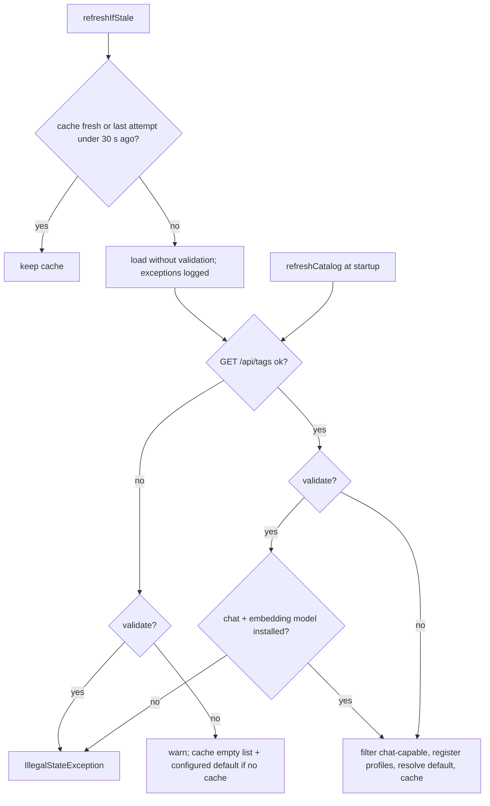

# LLM (`com.localmind.llm`)

Owns the model catalogue: which Ollama models are installed, which one is the default, which support tool calling,
and the token budget (`ModelProfile`) each model gets in the prompt pipeline. The catalogue is read from Ollama's
`/api/tags` at startup, cached, and reloaded during requests once the cache is empty or older than 5 minutes; there
are no hard-coded model lists. It also owns
`LlmProperties` (`localmind.llm.*`), whose `resolveModel` is used by `chat` and `conversation` to pick the model of a
request.

## Responsibilities

- Fetch `GET {ollamaBaseUrl}/api/tags` through the `shortTimeoutRestClient` bean, cache the chat-capable models and
  reload them when the cache is empty or stale.
- Fail startup when Ollama is unreachable, older than 0.30.0, or missing the default chat/embedding model
  (`localmind.llm.validate-models-on-startup`, default `true`).
- Register one `ModelProfile` per installed model (context window, output reserve, RAG/history budgets, tool support).
- Answer `supportsTools(model)` for `ToolSelector`.
- Serve `GET /api/models`.
- Resolve the model name of a request (`LlmProperties.resolveModel`).

## Package layout

| Class | Layer | Role |
| --- | --- | --- |
| [`ModelController`](../../../backend/src/main/java/com/localmind/llm/controller/ModelController.java) | controller | `GET /api/models` |
| [`ModelCatalogService`](../../../backend/src/main/java/com/localmind/llm/service/ModelCatalogService.java) | service | Ollama `/api/tags` fetch, startup validation, cache with TTL and retry throttle, tool-support lookup, default model |
| [`OllamaVersionCheck`](../../../backend/src/main/java/com/localmind/llm/service/OllamaVersionCheck.java) | service | Startup check that Ollama is 0.30.0 or later (`GET /api/version`) |
| [`ModelProfileRegistry`](../../../backend/src/main/java/com/localmind/llm/service/ModelProfileRegistry.java) | service | In-memory `ConcurrentHashMap` of `ModelProfile` keyed by `ModelNames.canonical` |
| [`ModelProfile`](../../../backend/src/main/java/com/localmind/llm/model/ModelProfile.java) | model | Token budgets and tool capability of one model |
| [`ModelNames`](../../../backend/src/main/java/com/localmind/llm/model/ModelNames.java) | model | The one model-name matching rule (`matches`, `canonical`) and the `LATEST_TAG` constant |
| [`ModelInfoResponse`](../../../backend/src/main/java/com/localmind/llm/dto/ModelInfoResponse.java) | dto | One installed model in the `/api/models` response |
| [`ModelResponse`](../../../backend/src/main/java/com/localmind/llm/dto/ModelResponse.java) | dto | `/api/models` response: models + default model |
| [`LlmProperties`](../../../backend/src/main/java/com/localmind/llm/config/LlmProperties.java) | config | `localmind.llm.*`; `resolveModel(String...)` |

Private nested records of `ModelCatalogService` bind the Ollama payload (unknown fields ignored):
`OllamaTagsResponse(models)`, `OllamaTagModel(name, model, size, modified_at, details, capabilities)`,
`ModelDetails(context_length, family, parameter_size)`, and the cache `CachedModels(models, defaultModel, fetchedAt)`.
Constants: `CACHE_TTL = 5 min`, `RETRY_INTERVAL = 30 s`.

## HTTP API

| Method | Path | Request body | Response | Status | Notes |
| --- | --- | --- | --- | --- | --- |
| `GET` | `/api/models` | none | `ModelResponse` | `200` | Bearer token required; served from the in-memory cache, reloaded first if stale |

- Every call runs `refreshIfStale()` first: the catalogue is reloaded when it is empty (Ollama was unreachable, or no
  chat-capable model is installed) or was fetched more than 5 minutes ago (`CACHE_TTL`), but at most once per 30 s
  (`RETRY_INTERVAL`) since the last attempt, successful or not. Models pulled after startup therefore appear within
  about 5 minutes without a restart. The reload never throws and never validates; a failure keeps the previous list.
- With Ollama down and no list loaded yet, the response is
  `{"models": [], "defaultModel": "<localmind.llm.default-model>"}`; Ollama is retried at most every 30 s (5 s
  connect/read timeout, loads serialized by `synchronized`).
- `defaultModel` is the installed model matching `localmind.llm.default-model` (by `name` or `model`, using the
  model-name rule in business rule 3, returned as the installed `name`: `llama3.2` configured with `llama3.2:latest`
  installed reports `llama3.2:latest`); if none matches, the first installed chat model; if none is
  installed, the configured value.
- Models are returned in the order Ollama lists them.

`ModelResponse` (`size` is bytes, `modifiedAt` is Ollama's `modified_at` string passed through unchanged):

```json
{
  "models": [
    {
      "name": "qwen2.5:7b",
      "model": "qwen2.5:7b",
      "size": 4683087332,
      "modifiedAt": "2026-10-02T14:21:07.123456+02:00",
      "supportsTools": true
    }
  ],
  "defaultModel": "gemma3:1b"
}
```

## Domain model

No entities.

### `ModelProfile` (record, `llm/model`)

| Field | Meaning | Consumer |
| --- | --- | --- |
| `modelName` | Key name (as registered) | `HistoryAdvisor` (logging) |
| `numCtx` | Context window sent to Ollama (`num_ctx`) | `ChatOrchestratorService` options, `PromptStatsAdvisor` overflow check |
| `outputReserve` | Tokens kept for the answer, sent as `num_predict` | `ChatOrchestratorService` options |
| `ragBudget` | Tokens for document excerpts | `AutoRagAdvisor` |
| `historyBudget` | Tokens for conversation history | `HistoryAdvisor` |
| `toolSupported` | Tool calling offered | `ModelCatalogService.supportsTools` fallback |

There are no other per-model fields (no think-tag/reasoning flag; `<think>` handling lives in `chat`'s
`StreamingTagParser` and `conversation`'s `ThinkTags`, independent of the profile).

Factories:

| Factory | Formula |
| --- | --- |
| `fromOllama(name, contextLength, toolSupported)` | `ctx` = `contextLength` clamped to `[4096, 32768]`, or `8192` if null/≤0; `outputReserve = min(2048, ctx/4)`; `remaining = ctx - outputReserve`; `ragBudget = max(1000, (int)(remaining*0.35))`; `historyBudget = max(1000, (int)(remaining*0.55))` |
| `generic(name, toolSupported)` | fixed `8192 / 1600 / 2000 / 3400` |

Resulting profiles (no hard-coded profiles exist; these are the only shapes produced):

| Source | `numCtx` | `outputReserve` | `ragBudget` | `historyBudget` | `toolSupported` |
| --- | --- | --- | --- | --- | --- |
| `fromOllama`, no `context_length` | 8192 | 2048 | 2150 | 3379 | `"tools"` in capabilities |
| `fromOllama`, `context_length` ≤ 4096 | 4096 | 1024 | 1075 | 1689 | idem |
| `fromOllama`, `context_length` = 16384 | 16384 | 2048 | 5017 | 7884 | idem |
| `fromOllama`, `context_length` ≥ 32768 | 32768 | 2048 | 10752 | 16896 | idem |
| `generic` (unknown model in registry) | 8192 | 1600 | 2000 | 3400 | `false` |

### DTOs

| Record | Fields | Validation |
| --- | --- | --- |
| `ModelInfoResponse` | `String name`, `String model`, `Long size`, `String modifiedAt`, `boolean supportsTools` | none |
| `ModelResponse` | `List<ModelInfoResponse> models`, `String defaultModel` | none |

## Business rules

0. **Minimum Ollama version** (`OllamaVersionCheck`, `@PostConstruct`): reads `GET /api/version`. Ollama 0.30.0 is the
   first release whose `/api/tags` reports `capabilities` and `details.context_length`; on older releases every model
   would silently lose tool support, embedding models would be listed as chat models and every profile would fall back
   to the 8192-token context. A release older than 0.30.0 throws `IllegalStateException` (startup fails) with
   validation on, and logs a warning with validation off. Comparison uses `major.minor.patch`, ignoring a leading `v`
   and any `-`/`+` suffix. Development builds (`0.0.0`), unparseable versions and an unreachable Ollama pass; the
   catalogue load below reports an unreachable Ollama.
1. **Catalogue load**: two `synchronized` entry points share one loader, which records `lastAttempt` before calling
   Ollama.
   - `refreshCatalog()` (public): the startup load, run from `@PostConstruct`. Validates when
     `validate-models-on-startup` is true, so it may fail startup.
   - `refreshIfStale()` (package-private): run at the start of `listAvailableModels` and
     `supportsTools`. Returns immediately when the cache is non-empty and younger than `CACHE_TTL` (5 min), or when the
     last attempt was less than `RETRY_INTERVAL` (30 s) ago. Otherwise reloads without validation; any
     `RuntimeException` is logged at `warn` and swallowed, so it never throws into a request.
2. **Ollama unreachable** (any exception from the GET): in the validating startup load, throws `IllegalStateException`
   (startup fails because it is thrown from `@PostConstruct`); otherwise logs a warning and, if no cache exists yet,
   caches `([], defaultModel)`. An existing cache is kept.
3. **Validation** (only in `refreshCatalog` when `validate-models-on-startup` is true, never on request-time reloads): both
   `default-model` and `default-embedding-model` must be in the tag list, else `IllegalStateException`. A tag matches
   when its `name` or `model` matches the target by the **model-name rule** (`ModelNames.matches`), which validation,
   the default model and `supportsTools` all use: case-insensitive and trimmed, a bare name equals its `:latest` tag
   in both directions (`llama3.2` ↔ `llama3.2:latest`), other tags never match (`qwen2.5` ≠ `qwen2.5:7b`), and a
   `null` or blank name (for example a tag without a `model` field) never matches.
4. **Chat-capable filter**: a tag is kept if its `capabilities` list is null/empty or contains `"completion"`. Tags
   with only `"embedding"` are excluded from `/api/models` and from the registry.
5. **Tool support**: `supportsTools = capabilities contains "tools"`.
6. **Profiles**: each kept tag registers `fromOllama(name, details.context_length, toolSupport)`, plus a second profile
   under `model` if it differs from `name`. Registry keys are `ModelNames.canonical(name)` (trimmed, lower-cased,
   trailing `:latest` removed); re-registration overwrites; profiles are never removed.
7. **`ModelProfileRegistry.getProfile(name)`**: a null/blank name returns `generic("default", false)`. Otherwise the
   canonical name is looked up, so the model-name rule applies (`custom-model` finds `custom-model:latest` and
   vice versa, but `qwen2.5` does not find `qwen2.5:7b`); else
   `generic(<trimmed name>, false)`. There is no prefix matching.
8. **`supportsTools(name)`**: `false` for null/blank. Otherwise, after `refreshIfStale()`, the first cached
   `ModelInfoResponse` whose `name` or `model` matches by the model-name rule decides. If none matches, falls back to `getProfile(name).toolSupported()` (`false` for
   unknown models).
9. **`LlmProperties.resolveModel(candidates...)`**: first non-blank candidate, trimmed; else `default-model`. Never
   returns blank.



## Side effects & async work

- External HTTP: `GET {localmind.llm.ollama-base-url}/api/version` once at startup (`OllamaVersionCheck`) and
  `GET {localmind.llm.ollama-base-url}/api/tags`, `Accept: application/json`, both via the
  `shortTimeoutRestClient` bean (`common.config.WebMvcConfig`, 5 s connect and read timeout). The shared
  `RestClient.Builder` is not customized.
- No database, Qdrant, `TransactionHooks`, `@Async` or `@Modifying` usage.
- In-memory state only: `volatile CachedModels` and `volatile Instant lastAttempt` in `ModelCatalogService`,
  `ConcurrentHashMap` in `ModelProfileRegistry`.

## Configuration

`LlmProperties` (`localmind.llm`):

| Property | Env var | Default | Effect |
| --- | --- | --- | --- |
| `localmind.llm.default-model` | `OLLAMA_CHAT_MODEL` | `gemma3:1b` (yml and compact constructor; blank → default, trimmed) | Model used when a request/conversation names none; required at startup when validating; preferred `defaultModel` in `/api/models`. Same variable as `spring.ai.ollama.chat.options.model` |
| `localmind.llm.default-embedding-model` | `OLLAMA_EMBEDDING_MODEL` | `nomic-embed-text` (blank → default, trimmed) | Only used for startup validation here; Spring AI's embedding model comes from `spring.ai.ollama.embedding.options.model` (same variable) |
| `localmind.llm.ollama-base-url` | `OLLAMA_BASE_URL` | `http://127.0.0.1:11434` (null/blank → default; trimmed, trailing `/` stripped) | Base of the `/api/tags` call. Same variable as `spring.ai.ollama.base-url` |
| `localmind.llm.validate-models-on-startup` | `VALIDATE_MODELS_ON_STARTUP` | `true` (`application.yml`, and the compact constructor when the key is absent: `Boolean`, `null` → `true`); `false` in `application-test.yml` | Fail fast when Ollama is unreachable, older than 0.30.0 or missing required models; when `false`, only warn |

## Errors

No `ApiException` is thrown by this feature.

| Situation | Exception | HTTP status | Message |
| --- | --- | --- | --- |
| Ollama unreachable, validation on | `IllegalStateException` (cause: client exception) | startup failure (request-time reloads never validate and never throw) | `Failed to connect to Ollama at '<url>'. LocalMind requires Ollama to be running on startup with models '<chat>' and '<embedding>'.` (log/startup only) |
| Ollama older than 0.30.0, validation on | `IllegalStateException` | startup failure | `Ollama <version> at '<url>' is too old. LocalMind needs Ollama 0.30.0 or later to detect which models support tools. Please upgrade Ollama.` (logged as a warning instead when validation is off) |
| Default chat model not installed, validation on | `IllegalStateException` | startup failure | `Required default chat model '<m>' was not found on the system. Please run 'ollama pull <m>' before starting LocalMind.` |
| Default embedding model not installed, validation on | `IllegalStateException` | idem | `Required default embedding model '<m>' was not found on the system. Please run 'ollama pull <m>' before starting LocalMind.` |
| No / invalid Bearer token on `/api/models` | security filter chain | 401 | written by `ProblemDetailSecurityHandler` |

## Interactions with other features

| Direction | Feature | Usage |
| --- | --- | --- |
| uses | `common` | `shortTimeoutRestClient` bean from `WebMvcConfig` |
| used by | `chat` | `ChatOrchestratorService`: `LlmProperties.resolveModel(request.model, conversation.modelName)` and `ModelProfileRegistry.getProfile(model)` (stored in the advisor context as `MODEL_PROFILE`, `numCtx`/`numPredict` options); `ToolSelector`: `ModelCatalogService.supportsTools`; `HistoryAdvisor`, `AutoRagAdvisor`, `PromptStatsAdvisor` read `ModelProfile` budgets |
| used by | `conversation` | `ConversationService.createConversation`, `AutoTitleService`, `ConversationSummaryService`: `LlmProperties.resolveModel` only |

## Tests

| Test class | What it covers |
| --- | --- |
| [`ModelControllerTest`](../../../backend/src/test/java/com/localmind/llm/controller/ModelControllerTest.java) | `@WebMvcTest`: 401 without token; authenticated response shape (`models[0].name`, `supportsTools`, `defaultModel`) |
| [`ModelCatalogServiceTest`](../../../backend/src/test/java/com/localmind/llm/service/ModelCatalogServiceTest.java) | `isToolCapable`; `IllegalStateException` when Ollama is unreachable with validation on; missing chat / embedding model; a mocked `/api/tags` (`MockRestServiceServer`) parsed into models, default model, tool support and context-length profiles with the embedding-only model skipped; a bare name matches only its `:latest` tag (`qwen2.5` does not match `qwen2.5:7b`); validation accepts a bare name for an installed `:latest` tag and vice versa but not another tag; a bare default model resolves to the installed `:latest` name and a `:latest` default to a bare installed name; a tag without a `model` field neither breaks the default model nor `supportsTools`; an unmatched default falls back to the first installed chat model; a request-time reload with validation on never throws and is not retried within 30 s |
| [`OllamaVersionCheckTest`](../../../backend/src/test/java/com/localmind/llm/service/OllamaVersionCheckTest.java) | Version comparison (old, current, `v` prefix, pre-release, dev build, garbage); startup failure vs warning for an old Ollama; supported version passes; unreadable version skipped |
| [`ModelProfileRegistryTest`](../../../backend/src/test/java/com/localmind/llm/service/ModelProfileRegistryTest.java) | Register/retrieve, untagged name matches `:latest`, unknown model gets generic 8192 profile, blank name gets `generic("default", false)` even with profiles registered, bare name does not match a non-`:latest` tag, a `:latest` lookup finds a profile registered under the bare name |
| [`ModelNamesTest`](../../../backend/src/test/java/com/localmind/llm/model/ModelNamesTest.java) | Bare name ↔ `:latest` both ways, other tags never match, null/blank never match, `canonical` |
| [`LlmPropertiesTest`](../../../backend/src/test/java/com/localmind/llm/config/LlmPropertiesTest.java) | Defaults for absent values (validation on), blank `ollama-base-url` → default, URL trimmed without trailing `/`, binding without the key keeps validation on |
| [`OfflineModelCatalog`](../../../backend/src/test/java/com/localmind/support/OfflineModelCatalog.java) | Test double (not a test): `supportsTools` from the registry only, used by `ToolSelectorTest` and `ChatOrchestratorServiceTest` |

Not covered: reload after `CACHE_TTL` expiry.
