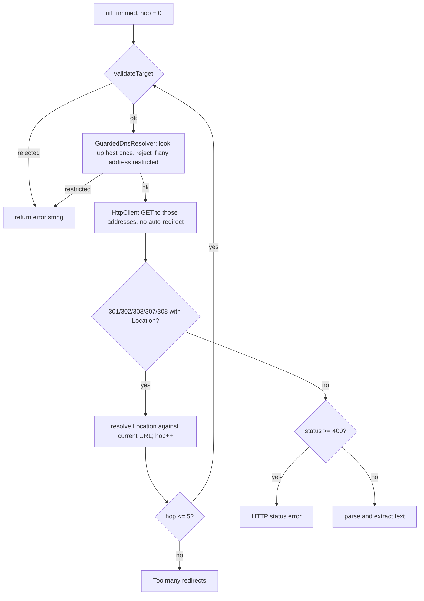

# Tools (`com.localmind.tools`)

The `tools` feature owns the functions a tool-capable model may call during a chat turn: clock, calculator, long-term
memory save/recall, private web search through SearXNG, an SSRF-guarded web page reader and semantic search over the
conversation's uploaded documents. Each tool is a Spring `@Component` that exposes a Spring AI `ToolCallback` built with
`FunctionToolCallback.builder(...)` (there are no `@Tool`-annotated methods). Tools never throw into the LLM pipeline:
every failure becomes a readable string returned to the model. Tenant identifiers (`userId`, `conversationId`) come from
the server-built `ToolContext`, never from model arguments.

## Responsibilities

- Define the name, description and JSON input schema (a request record) of each tool given to the model.
- Execute the tool and return plain text formatted for the model, with fixed result counts and character caps.
- Read the authenticated user and conversation from the `ToolContext` (`ChatContextKeys.USER_ID`,
  `ChatContextKeys.CONVERSATION_ID`) for tenant-scoped tools.
- Persist and embed user memories (`saveUserMemory`), keeping MySQL and Qdrant consistent.
- Query Qdrant with the multi-tenant `VectorFilters` (`documentChunks`, `userMemories`).
- Call SearXNG over the `shortTimeoutRestClient`.
- Fetch model-chosen URLs with an SSRF guard that validates every redirect hop.

Not owned here: which tools are offered per turn (`chat.prompt.ToolSelector`), the per-turn call cap, SSE
`TOOL_START`/`TOOL_END` events and the audit trail (`chat.service.MonitoredToolCallback`). See
[PROMPT_GENERATION_PROCESS.md](../../PROMPT_GENERATION_PROCESS.md).

## Package layout

| Class | Layer | Role |
| --- | --- | --- |
| [`SearxngProperties`](../../../backend/src/main/java/com/localmind/tools/config/SearxngProperties.java) | config | `localmind.tools.searxng` record: SearXNG base URL (trailing `/` stripped). |
| [`WebScraperProperties`](../../../backend/src/main/java/com/localmind/tools/config/WebScraperProperties.java) | config | `localmind.tools.scraper` record: `allowPrivateSubnets` switch that disables the SSRF guard. |
| [`DateTimeTools`](../../../backend/src/main/java/com/localmind/tools/service/DateTimeTools.java) | service | `getCurrentDateTime` tool. |
| [`MathTools`](../../../backend/src/main/java/com/localmind/tools/service/MathTools.java) | service | `calculateExpression` tool (exp4j). |
| [`UserMemoryTools`](../../../backend/src/main/java/com/localmind/tools/service/UserMemoryTools.java) | service | `saveUserMemory` and `recallUserMemories` tools. |
| [`WebSearchTools`](../../../backend/src/main/java/com/localmind/tools/service/WebSearchTools.java) | service | `searchWeb` tool (SearXNG JSON API). |
| [`WebScraperTools`](../../../backend/src/main/java/com/localmind/tools/service/WebScraperTools.java) | service | `readWebPage` tool (Apache HttpClient 5 with an SSRF-guarded DNS resolver, Jsoup for parsing, manual redirects). |
| [`DocumentSearchTools`](../../../backend/src/main/java/com/localmind/tools/service/DocumentSearchTools.java) | service | `searchUploadedDocs` tool (Qdrant similarity search). |
| [`ToolContexts`](../../../backend/src/main/java/com/localmind/tools/service/ToolContexts.java) | service | Package-private helper: reads a non-blank string from a `ToolContext` via `ChatContextKeys.getString`, `null` if absent/blank or the context is `null`. |

## Tool catalogue

There is no HTTP API; the feature has no controller. Tools are reached only through the chat stream
(`POST /api/chat/stream`, owned by the `chat` feature).

| Tool name | Class / callback factory | Input record (JSON) | Context keys read | Offered when |
| --- | --- | --- | --- | --- |
| `getCurrentDateTime` | `DateTimeTools#toolCallback()` | `DateTimeRequest()` → `{}` | none | always |
| `calculateExpression` | `MathTools#toolCallback()` | `MathRequest` → `{"expression": "2^10"}` (required) | none | always |
| `saveUserMemory` | `UserMemoryTools#saveToolCallback()` | `SaveMemoryRequest` → `{"fact": "Prefers metric units"}` (required) | `userId` | always |
| `recallUserMemories` | `UserMemoryTools#recallToolCallback()` | `RecallMemoryRequest` → `{"query": "units"}` (optional) | `userId` | always |
| `searchWeb` | `WebSearchTools#toolCallback()` | `WebSearchRequest` → `{"query": "spring ai"}` (required) | none | always |
| `readWebPage` | `WebScraperTools#toolCallback()` | `WebScrapeRequest` → `{"url": "https://example.com"}` (required) | none | message contains a URL marker |
| `searchUploadedDocs` | `DocumentSearchTools#toolCallback()` | `DocumentSearchRequest` → `{"query": "termination clause"}` (required) | `userId`, `conversationId` | conversation has a `READY` attachment |

"Required" is `@JsonProperty(required = true)`, which only marks the property as required in the generated JSON schema;
a missing or `null` value still reaches the method and is handled by the blank-input checks below. A `null` request
object is mapped to a `null` argument by every callback.

### Selection (brief)

[`ToolSelector#selectTools(model, message, conversationId, toolsRequested)`](../../../backend/src/main/java/com/localmind/chat/prompt/ToolSelector.java)
returns no tools when `toolsRequested` is `false` or `ModelCatalogService.supportsTools(model)` is `false`. Otherwise it
returns, in order: `getCurrentDateTime`, `calculateExpression`, `saveUserMemory`, `recallUserMemories`, `searchWeb`; plus
`readWebPage` if the lower-cased message contains `http://`, `https://` or `www.`; plus `searchUploadedDocs` if
`conversationId != null` and `AttachmentRepository.existsByConversationIdAndStatus(conversationId, READY)`.
`ChatOrchestratorService` wraps each in `MonitoredToolCallback` (at most 5 executed calls per turn, shared across tools)
and sets the tool context to `{userId, conversationId}`. Details live in the chat feature page.

### `getCurrentDateTime`

| Aspect | Value |
| --- | --- |
| Description | `Get the current date, time, day of the week, and local system timezone.` |
| Parameters | none |
| Returns | `Current Date & Time: <ISO_OFFSET_DATE_TIME> (<DAY_OF_WEEK>, Timezone: <zone id>)`, e.g. `Current Date & Time: 2026-11-16T10:15:30.123+01:00 (MONDAY, Timezone: Europe/Berlin)` |
| Limits | none; uses the JVM default time zone (`ZonedDateTime.now()`) |
| Error strings | none |

### `calculateExpression`

| Aspect | Value |
| --- | --- |
| Description | `Evaluate a mathematical expression. Supports +, -, *, /, ^, %, parentheses, and standard math functions like sqrt, sin, cos, abs.` |
| Parameters | `expression` (string); trimmed, evaluated with exp4j `new ExpressionBuilder(expr).build().evaluate()` (no variables) |
| Returns | Whole results within `long` range as an integer string (`1024`); otherwise `Double.toString` (`0.5`, `1.0E20`) |
| Limits | none beyond exp4j |

| Situation | Returned string |
| --- | --- |
| `expression` null/blank | `Error: Expression cannot be null or blank.` |
| `ArithmeticException` (e.g. `1/0`) | `Error: Division by zero.` |
| `IllegalArgumentException` (syntax) | `Error: Invalid mathematical syntax.` |
| any other exception | `Error: the expression could not be evaluated.` |
| result `NaN` | `Error: Mathematical result is NaN (Not a Number).` |
| result infinite | `Error: Division by zero or infinite result.` |

### `saveUserMemory`

| Aspect | Value |
| --- | --- |
| Description | `Save a factual memory or personal preference about the user for future recall across conversations.` |
| Parameters | `fact` (string); trimmed before storing |
| Context | `ChatContextKeys.USER_ID` |
| Returns | `Memory saved successfully: <trimmed fact>`; `Memory already saved: <trimmed fact>` when the user already has a memory with exactly this text (`UserMemoryRepository.existsByUserIdAndMemoryFact(userId, trimmedFact)`), in which case nothing is stored |
| Effects | Inserts a `user_memories` row (new UUID id, `user_id`, `memory_fact`; `pinned=false`, `created_at` from `@PrePersist`), then adds one Qdrant document with text = fact and metadata `{userId, type: "USER_MEMORY", memoryId}`. If the vector add throws, the row is deleted again (`deleteById`) and the error string is returned. |
| Limits | trimmed fact at most 1000 characters (`MAX_FACT_LENGTH`); the column is `TEXT` |

| Situation | Returned string |
| --- | --- |
| `fact` null/blank | `Error: Memory fact must not be null or blank.` |
| `userId` missing from context | `Error: Security context missing authenticated user ID.` |
| trimmed fact longer than 1000 characters | `Error: Memory fact is too long (more than 1000 characters). Save a shorter summary of the fact.` |
| duplicate check, DB save or vector add fails | `Error: the memory could not be saved right now.` |

### `recallUserMemories`

| Aspect | Value |
| --- | --- |
| Description | `Recall or retrieve previously saved user facts, personal preferences, and notes relevant to a topic or query.` |
| Parameters | `query` (string, optional) |
| Context | `ChatContextKeys.USER_ID` |
| Algorithm | If `query` is non-blank: Qdrant similarity search on the trimmed query, `topK = 5`, `similarityThreshold = 0.3`, filter `VectorFilters.userMemories(userId)` (`userId == ? AND type == "USER_MEMORY"`). Non-empty result → `Recalled User Memories for '<query>':` followed by `1. <text>` lines. Empty result, failed search (logged at debug, swallowed) or no query → the newest 20 rows (`MAX_LISTED_MEMORIES`) of `UserMemoryRepository.findByUserIdOrderByCreatedAtDesc(userId)` as `Saved User Memories:` + numbered lines; when the user has more than 20 memories the header is `Saved User Memories (newest 20 of <total>):`. |
| Limits | semantic path: 5 results; fallback path: 20 newest memories |

| Situation | Returned string |
| --- | --- |
| `userId` missing from context | `Error: Security context missing authenticated user ID.` |
| no memories in DB (fallback path) | `No saved user memories found.` |
| DB read fails | `Error: saved memories could not be recalled right now.` |

### `searchWeb`

| Aspect | Value |
| --- | --- |
| Description | `Search the web for current, up-to-date real-time information via privacy-preserving search engine. Returns top results with titles, URLs, and summaries.` |
| Parameters | `query` (string); trimmed once in `formatResults`, and the trimmed value is sent and used in every returned string |
| HTTP call | `GET {localmind.tools.searxng.base-url}/search?q=<trimmed query>&format=json`, `Accept: application/json`, via the `shortTimeoutRestClient` bean (connect and read timeout 5 s, `WebMvcConfig`). Body bound to `SearxngResponse(List<SearxngItem> results)`, `SearxngItem(title, url, content)`; unknown JSON properties ignored. |
| Returns | `Web Search Results for '<trimmed query>':` then per result `N. <title>` / `"   URL: <url>"` / `"   Snippet: <content>"`, blank line between results, trimmed. Null `title`/`url`/`content` become `""`. |
| Limits | first 5 results (`MAX_RESULTS`); snippets are not truncated |

| Situation | Returned string |
| --- | --- |
| query null/blank (no HTTP call) | `Error: Search query must not be blank.` |
| no results, or body/`results` null | `No web search results found for query: <trimmed query>` |
| HTTP error status, timeout, connection or parse error | `Error: Web search is unavailable right now. Answer without web results and tell the user that search could not be reached.` The package-private `searchWeb` lets the exception propagate; `formatResults` catches `RuntimeException`, logs it at `warn` and returns this fixed string, so the model can tell an outage from an empty result. |

### `readWebPage`

| Aspect | Value |
| --- | --- |
| Description | `Fetch and extract readable text content from a web page URL (HTTP/HTTPS). Strips extraneous scripts/styles and returns up to 4,000 characters of clean content.` |
| Parameters | `url` (string); trimmed |
| HTTP call | Its own Apache HttpClient 5 instance (closed on shutdown): `User-Agent: LocalMindBot/1.0 (Privacy-first AI Assistant; +https://github.com/gitApurv/LocalMind)`, 10 s connect, socket and response timeouts, redirects, retries and cookies disabled, DNS through `GuardedDnsResolver`. The body is read up to 2 MiB (longer bodies are truncated) and parsed with Jsoup using the response charset. Not routed through `shortTimeoutRestClient`. |
| Extraction | Removes `script, style, noscript, nav, footer, header, svg, form`; takes `body().text()` (or `document.text()` without a body); collapses whitespace runs to one space. |
| Returns | The page text; if longer than 4 000 chars, the first 4 000 + `... [Content truncated to 4,000 characters]`. |
| Limits | 5 redirects, 10 s timeout per request, 2 MiB body, 4 000 output chars |

| Situation | Returned string |
| --- | --- |
| `url` null/blank | `Error: URL must not be null or blank.` |
| scheme not `http://`/`https://` (case-insensitive) | `Error: Invalid URL scheme. Only HTTP and HTTPS URLs are permitted.` |
| `URI.create` fails | `Error: Invalid URL format.` |
| URI has no host | `Error: URL does not specify a valid host.` |
| host resolves to a restricted address (any hop) | `Error: Access to private or loopback IP addresses is restricted (SSRF protection).` |
| DNS lookup fails | `Error: Target host could not be resolved: <host>` |
| `Content-Type` is not `text/*`, `application/xml` or `*+xml` (e.g. PDF, JSON, images) | `Error fetching web page (<url>): the content is not a readable text or HTML page.` |
| final response status ≥ 400 | `Error fetching web page (<url>): HTTP <status>` |
| more than 5 redirects | `Error: Too many redirects (more than 5).` |
| page has no text after cleanup | `The web page at <url> contained no readable text content.` |
| any other exception (I/O, timeout, bad `Location`) | `Error fetching web page (<url>): the page could not be retrieved.` |

#### SSRF defence

1. **Per-hop validation.** `validateTarget` runs before every request, including each redirect target: scheme check,
   `URI.create`, non-blank host. The address check happens in the resolver (step 3) for every hop.
2. **Redirects.** The HTTP client never follows redirects itself. A 301/302/303/307/308 response with a `Location` header is
   resolved against the current URL (`URI.resolve`, so relative locations work) and loops back to validation. At most 6
   requests are made (hops 0–5); if the 6th response is still a redirect the tool returns the too-many-redirects error.
   A 3xx without `Location` is treated as a normal response (status < 400, body parsed).
3. **Host check in the DNS resolver.** The HTTP client gets addresses only from `GuardedDnsResolver`. It rejects host
   `localhost` or `*.localhost` without DNS if the loopback address is restricted; otherwise it calls
   `InetAddress.getAllByName(host)` once and rejects the host if **any** resolved address is restricted (logged at
   `warn` with host and address). The connection uses exactly the addresses it returned, and IP literals go through
   the same path. Because nothing resolves the host a second time, a DNS server cannot answer the check with a public
   address and the connection with a private one (DNS rebinding). This does not depend on the JVM's DNS cache
   (`networkaddress.cache.ttl`).
4. **Restricted addresses** (`isRestrictedAddress`):

   | Range | Rule |
   | --- | --- |
   | `127.0.0.0/8`, `::1` | `isLoopbackAddress()` |
   | `10.0.0.0/8`, `172.16.0.0/12`, `192.168.0.0/16`, `fec0::/10` | `isSiteLocalAddress()` |
   | `169.254.0.0/16`, `fe80::/10` | `isLinkLocalAddress()` |
   | `0.0.0.0`, `::` | `isAnyLocalAddress()` |
   | `224.0.0.0/4`, `ff00::/8` | `isMulticastAddress()` |
   | `0.0.0.0/8` | first octet `0` |
   | `100.64.0.0/10` (CGNAT) | first octet `100`, second `64`–`127` |
   | `192.0.0.0/24` (IETF protocol assignments) | octets `192.0.0` |
   | `198.18.0.0/15` (benchmarking) | first octet `198`, second `18` or `19` |
   | `240.0.0.0/4` (reserved, incl. broadcast `255.255.255.255`) | first octet ≥ `240` |
   | `fc00::/7` (IPv6 unique-local) | `(byte0 & 0xFE) == 0xFC` |
   | `2001::/32` (Teredo) | first word `0x2001`, second word `0` |
   | `64:ff9b:1::/48` (local-use NAT64) | words `0064:ff9b:0001` |
   | `::ffff:a.b.c.d` (IPv4-mapped), `::a.b.c.d` (IPv4-compatible) | first 10 bytes zero, bytes 10–11 `ffff` or `0000`; embedded IPv4 (last 4 bytes) re-checked with the same rules |
   | `64:ff9b::/96` (well-known NAT64) | embedded IPv4 (last 4 bytes) re-checked |
   | `2002::/16` (6to4) | embedded IPv4 (bytes 2–5) re-checked |

   An address embedding a public IPv4 (e.g. `::ffff:8.8.8.8`, `64:ff9b::8.8.8.8`, `2002:808:808::1`) is allowed.

5. **`allowPrivateSubnets`.** When `localmind.tools.scraper.allow-private-subnets=true`, the resolver returns the
   looked-up addresses unchecked (scheme and host checks still apply). Intended only for local testing; default `false`.
6. Package-private constructors accept a custom `Predicate<InetAddress>` and a `HostLookup`, so tests can allow
   loopback while applying the production rule to everything else, and can simulate a rebinding DNS server.

### `searchUploadedDocs`

| Aspect | Value |
| --- | --- |
| Description | `Search uploaded documents and file attachments in the current conversation for relevant information, excerpts, and answers.` |
| Parameters | `query` (string); trimmed |
| Context | `ChatContextKeys.USER_ID`, `ChatContextKeys.CONVERSATION_ID` |
| Qdrant read | similarity search, `topK = 4`, `similarityThreshold = 0.4`, filter `VectorFilters.documentChunks(userId, conversationId)` (`userId == ? AND conversationId == ? AND type == "DOC_CHUNK"`) |
| Returns | `Found <n> relevant excerpt(s) in uploaded documents for '<query>':` then per match `--- Excerpt N (Source: <fileName metadata or "Unknown Document">) ---` + trimmed chunk text, trimmed overall |
| Limits | 4 excerpts; excerpt text not truncated (chunk size set by the attachment ETL) |

| Situation | Returned string |
| --- | --- |
| `query` null/blank | `Error: Document search query must not be null or blank.` |
| `userId` or `conversationId` missing | `Error: Security context missing authenticated user ID or conversation ID.` |
| no matches | `No relevant information found in uploaded documents for query: '<query>'.` |
| vector store throws | `Error: uploaded documents could not be searched right now.` |

## Domain model

No entities of its own. `saveUserMemory`/`recallUserMemories` use `memory.entity.UserMemory` (`user_memories`) and
`memory.repository.UserMemoryRepository`; see the memory feature page.

Records (all public nested records of the tool classes unless noted; no Bean Validation):

| Record | Fields |
| --- | --- |
| `DateTimeTools.DateTimeRequest` | none |
| `MathTools.MathRequest` | `expression` (`@JsonProperty(required = true)`) |
| `UserMemoryTools.SaveMemoryRequest` | `fact` (`required = true`) |
| `UserMemoryTools.RecallMemoryRequest` | `query` (`required = false`) |
| `WebSearchTools.WebSearchRequest` | `query` (`required = true`) |
| `WebSearchTools.SearchResult` (package-private) | `title`, `url`, `snippet` |
| `WebSearchTools.SearxngResponse` (package-private, `@JsonIgnoreProperties(ignoreUnknown = true)`) | `results: List<SearxngItem>` |
| `WebSearchTools.SearxngItem` (package-private, ignore unknown) | `title`, `url`, `content` |
| `WebScraperTools.WebScrapeRequest` | `url` (`required = true`) |
| `DocumentSearchTools.DocumentSearchRequest` | `query` (`required = true`) |

## Business rules

1. Tenant-scoped tools read `userId`/`conversationId` only from the `ToolContext`; blank values count as missing and
   produce an error string, never a fallback.
2. Every Qdrant query uses a `VectorFilters` expression scoped to the user (and conversation for documents).
3. A memory is saved to MySQL first, then embedded; if embedding fails the row is deleted so both stores stay in sync.
4. `saveUserMemory` stores a fact only once per user: an exact duplicate of the trimmed text is not saved again.
5. `recallUserMemories` falls back to listing the user's 20 newest memories when the query is blank, the
   semantic search returns nothing, or it fails.
6. Result caps: 5 web results, 5 recalled memories (semantic), 20 listed memories (fallback), 4 document excerpts,
   4 000 page characters; a saved fact is at most 1000 characters.
7. `readWebPage` validates scheme, host and resolved addresses on every hop; at most 5 redirects.
8. Tools return strings for every failure; exception details go to logs only.

## Side effects & async work

- No `TransactionHooks`, `@Async` or `@Modifying` usage. `saveUserMemory` runs outside any explicit transaction:
  `UserMemoryRepository.existsByUserIdAndMemoryFact` and `save` each run on their own, `save` commits on its own, then `vectorStore.add` runs; the compensating `deleteById` is manual.
- Qdrant writes: `saveUserMemory` adds one point with metadata `userId`, `type=USER_MEMORY`, `memoryId`.
- Qdrant reads: `recallUserMemories` (`VectorFilters.userMemories`), `searchUploadedDocs`
  (`VectorFilters.documentChunks`, reads metadata `fileName`). No deletes.
- External HTTP: SearXNG `GET /search` (5 s timeouts) and arbitrary public web pages via Apache HttpClient 5 (10 s timeouts, SSRF-guarded DNS resolver).

## Configuration

| Property | Env var | Default | Effect |
| --- | --- | --- | --- |
| `localmind.tools.searxng.base-url` | `SEARXNG_BASE_URL` | `http://127.0.0.1:8081` (yml and record) | SearXNG endpoint; a trailing `/` is removed. |
| `localmind.tools.scraper.allow-private-subnets` | `SCRAPER_ALLOW_PRIVATE_SUBNETS` | `false` | `true` disables the address check in `readWebPage`. |

Hard-coded constants (not configurable): result counts, similarity thresholds, scraper timeout/body size/redirect
limit/user agent. The SearXNG timeouts come from `common.config.WebMvcConfig` (`HTTP_CLIENT_TIMEOUT = 5s`).

## Errors

No `ApiException` is thrown; every tool failure is a string returned to the model (tables above). If a tool did throw,
`MonitoredToolCallback` would return `Error executing tool (<name>). Continue without its result.`

| Situation | Exception | HTTP status | Client message |
| --- | --- | --- | --- |
| None | — | — | — |

## Interactions with other features

- Uses: `memory.entity.UserMemory`, `memory.repository.UserMemoryRepository`; `common.ai.ChatContextKeys`,
  `VectorFilters`, `VectorMetadata`; `common.config.WebMvcConfig#shortTimeoutRestClient`; Spring AI `VectorStore`
  (Qdrant, documents written by the `attachment` ETL).
- Used by: `chat.prompt.ToolSelector` (selects callbacks) and `chat.service.ChatOrchestratorService` (wraps them in
  `MonitoredToolCallback`, supplies the tool context).

## Tests

| Test class | What it covers |
| --- | --- |
| [`DateTimeToolsTest`](../../../backend/src/test/java/com/localmind/tools/service/DateTimeToolsTest.java) | Output format; callback invocation. |
| [`MathToolsTest`](../../../backend/src/test/java/com/localmind/tools/service/MathToolsTest.java) | Parameterised valid expressions, division by zero, syntax error, blank input, fixed error messages without exception text, callback. |
| [`UserMemoryToolsTest`](../../../backend/src/test/java/com/localmind/tools/service/UserMemoryToolsTest.java) | Save (DB + vector metadata), missing user, blank fact, fact over 1000 characters rejected without storing, exact duplicate not stored again, semantic recall, DB fallback, fallback capped to the newest 20 with the `newest N of M` header, callbacks. |
| [`WebSearchToolsTest`](../../../backend/src/test/java/com/localmind/tools/service/WebSearchToolsTest.java) | SearXNG request URL and parsing (`MockRestServiceServer`), blank query (no HTTP call), server error reported as the fixed "unavailable" string instead of "no results", trimmed query in the no-results message, callback formatting. |
| [`WebScraperToolsTest`](../../../backend/src/test/java/com/localmind/tools/service/WebScraperToolsTest.java) | Local `HttpServer`: extraction, truncation, uppercase scheme, bad schemes, connection failure, SSRF ranges, redirect follow, redirect into private network, redirect loop, CGNAT/ULA/mapped ranges, parameterised special-purpose IPv4 ranges (`192.0.0.0/24`, `198.18.0.0/15`, `240.0.0.0/4`, broadcast) and IPv6 forms embedding IPv4 (NAT64, local-use NAT64, 6to4, Teredo, IPv4-compatible, IPv4-mapped; public embedded addresses allowed), a single checked DNS lookup per hop under a rebinding DNS answer, host with any private address blocked, connection through the guarded resolver, non-text content rejected. |
| [`DocumentSearchToolsTest`](../../../backend/src/test/java/com/localmind/tools/service/DocumentSearchToolsTest.java) | Match formatting, empty result, missing context, blank query, callback. |
| [`ToolSelectorTest`](../../../backend/src/test/java/com/localmind/chat/prompt/ToolSelectorTest.java) | No tools for unsupported model / tools off; doc search only with READY attachments; scraper only with a URL. |
