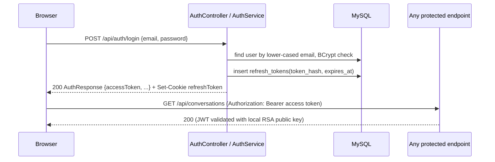
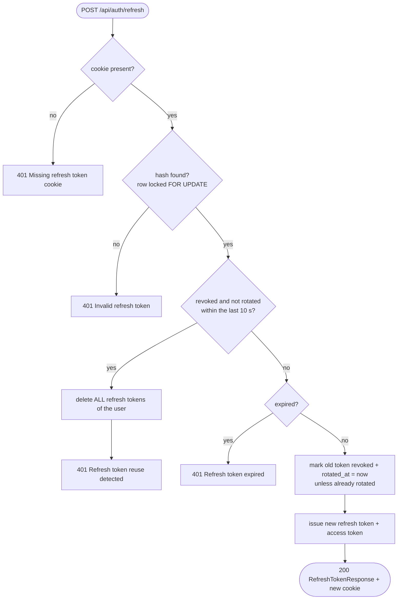

# Flow: authentication session

How a browser session is created, kept alive and ended. Endpoint details, DTOs and error strings are on the
[auth feature page](../features/auth.md); the security model is on [security.md](../security.md).

## Tokens

| Token | Format | Lifetime | Stored by the client | Stored by the server |
| --- | --- | --- | --- | --- |
| Access token | RS256 JWT: `iss=localmind`, `sub` and `userId` = user id, `email`, `fullName`, `iat`, `exp` | `localmind.jwt.access-token-expiration` (15 min) | In memory, sent as `Authorization: Bearer` | Nothing (stateless) |
| Refresh token | 32 random bytes, Base64URL | `localmind.jwt.refresh-token-expiration` (7 days) | `refreshToken` cookie: `HttpOnly`, `Path=/api/auth`, `Secure`/`SameSite` from config | SHA-256 hex digest in `refresh_tokens` |

## Login and authenticated requests

Registration (`POST /api/auth/register`) only creates the user and returns `201 UserSummary`; it issues no tokens, so
the client logs in afterwards.

## Refresh and rotation

When the access token expires, a protected call returns 401 and the client calls `POST /api/auth/refresh`. The
browser sends the cookie automatically because its path is `/api/auth`.

- **Reuse detection.** Presenting a revoked token is treated as theft: every refresh token of the user is deleted,
  ending all sessions. `refresh` is annotated `@Transactional(noRollbackFor = UnauthorizedException.class)` so that
  delete commits even though the request fails.
- **Grace window.** A token rotated less than 10 seconds ago is still accepted, and each caller gets its own new token.
  This covers several browser tabs refreshing at once with the same cookie.
- **No absolute session limit.** Each rotation issues a token with a full new lifetime.

## Logout

`POST /api/auth/logout` deletes the presented refresh token's row, expires the cookie (`Max-Age=0`) and always answers
`204`. The access token stays valid until it expires; the client discards it.

Presenting the logged-out cookie to `/refresh` again fails with `401 Invalid refresh token`. The row is deleted rather
than revoked on purpose: a revoked token would trigger reuse detection and end every other session of the user.

## Signing key

The RSA key pair is loaded from `localmind.jwt.key-file` and generated on first start, so access tokens survive a
restart. On POSIX file systems the file is created with owner-only `rw-------` permissions in the same call, so the
private key is never readable by other users. Deleting the file invalidates every outstanding access token; refresh tokens keep working because they are
opaque values checked against the database.
