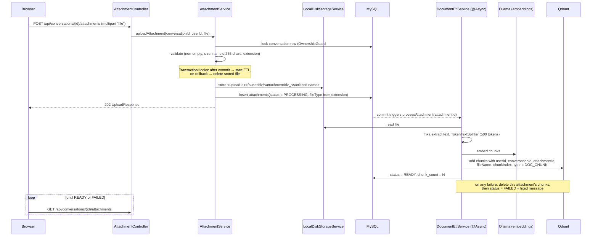

# Flow: document ingestion

How an uploaded file becomes searchable document chunks in Qdrant, and how it is removed again. Endpoint and
validation details are on the [attachment feature page](../features/attachment.md).

## Upload to searchable chunks

### Steps

1. **Lock and validate.** `OwnershipGuard#lockOwnedConversation` loads the caller's conversation with a
   `PESSIMISTIC_WRITE` lock held until the upload commits (403 if it is missing or another user's). A conversation
   delete takes the same lock first, so an upload either commits before the delete collects the attachments (and is
   deleted with them) or waits and then fails with 403. The file must be non-empty, at most
   `localmind.storage.max-file-size`, have a name of at most 255 characters and an allowed extension
   (`localmind.storage.allowed-extensions`, a subset of `SupportedFileType`). Files larger than the multipart limit are
   rejected by Spring with 413 before the service runs.
2. **Store and persist.** The transaction hooks are registered first, then the file is written to disk and the row is
   saved as `PROCESSING` with a `fileType` derived from the extension. If the transaction rolls back (including a
   failure half-way through writing the file), the stored file is deleted.
3. **Process after commit.** `DocumentEtlService#processAttachment` runs `@Async` on a virtual thread once the row is
   visible. Tika extracts text (up to 5,000,000 characters); `TokenTextSplitter` cuts it into chunks of 500 tokens
   (minimum 50 characters, at most 5,000 chunks); each chunk gets the metadata above and is embedded and stored in one
   `vectorStore.add` call.
4. **Finish.** The attachment becomes `READY` with its `chunkCount` (0 for a document with no text). On any failure
   (extraction, splitting, a `vectorStore.add` that wrote only part of the chunks, or recording `READY`), the job first
   deletes the chunks of this attachment (`userId`, `attachmentId`, `type = DOC_CHUNK`), so a failed document is never
   retrieved, then records `FAILED` with the fixed message "The document could not be processed. Check that the file is
   a valid, unencrypted document and upload it again." Details are only logged. If recording `FAILED` also fails (for
   example the database is down), that is logged and the row stays `PROCESSING` until the next start.
5. **Poll.** The frontend polls the attachment list until no attachment is `PROCESSING`.

If the conversation was deleted while the job ran, the status update matches no row and the job deletes the chunks of
the attachment it just wrote.

The job runs in memory, so a restart abandons it. On the next start (`ApplicationReadyEvent`),
`InterruptedIngestionRecovery` marks every attachment still `PROCESSING` as `FAILED` with "Processing was interrupted by
a server restart. Please upload the file again.", so polling ends and the user can upload the file again.

## Using the chunks

Chunks are only ever searched with `VectorFilters.documentChunks(userId, conversationId)`, so a conversation sees only
its own documents:

- `AutoRagAdvisor` injects relevant excerpts into the prompt when `localmind.prompt.rag.auto` is on and the
  conversation has a `READY` attachment ([chat](../features/chat.md)).
- The `searchUploadedDocs` tool lets the model search explicitly; it is offered only when the conversation has a
  `READY` attachment ([tools](../features/tools.md)).

## Removal

There is no endpoint to delete a single attachment. Deleting a conversation (`DELETE /api/conversations/{id}`)
deletes its attachment rows in the same transaction and registers an after-commit hook that:

1. deletes every stored file of those attachments, then
2. deletes the conversation's `DOC_CHUNK` vectors from Qdrant (`VectorFilters.documentChunks`).

Failures in these hooks are logged and do not affect the already committed delete.
